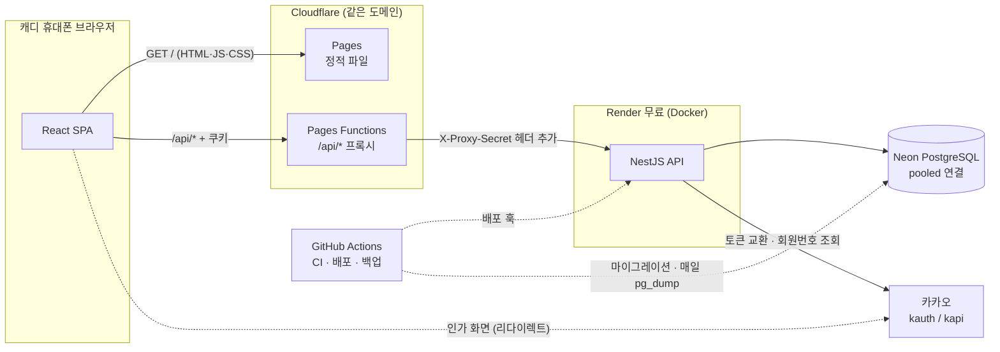
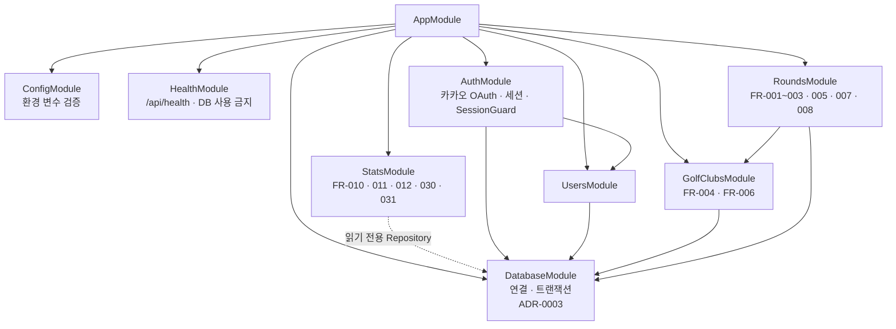
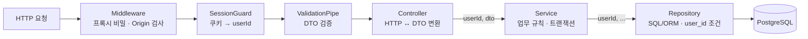
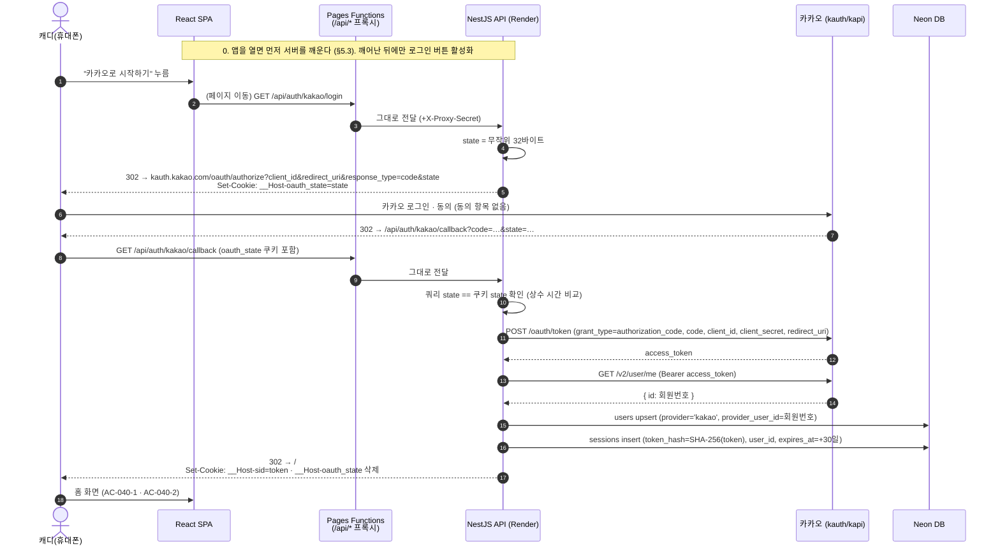
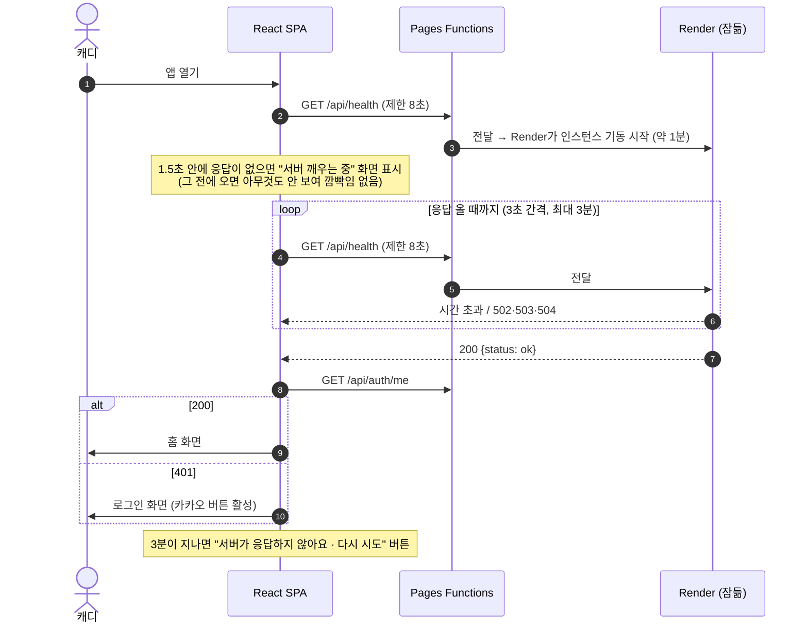
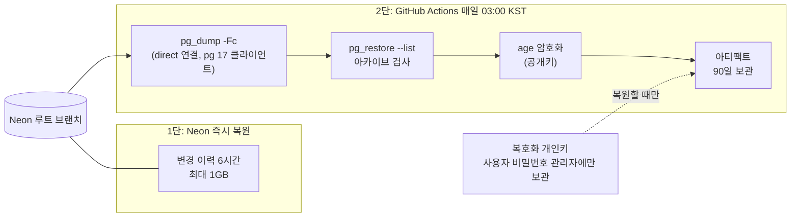

# 시스템 아키텍처

> 상태: **확정** · 최종 수정일: 2026-11-27
> 선행 조건: SRS Must 요구사항 확정, ADR-0002(기술 스택)
> 관련 결정: ADR-0002 기술 스택 · ADR-0009 프론트 라이브러리 · ADR-0004 로그인 세션 · ADR-0005 데이터 분리 강제 · ADR-0006 백업 · ADR-0007 모노레포 · ADR-0003 ORM(Drizzle) · 데이터 모델: `data-model.md`

이 문서의 코드 예시는 **설계 의도를 보여주는 의사 코드**다. 실제 문법은 Drizzle(ADR-0003)을 따르지만, 규칙(시그니처, 쿼리 조건, 쿠키 속성)은 그대로 지킨다.

---

## 1. 아키텍처 개요



| 구성 요소 | 역할 | 상태 저장 |
|---|---|---|
| React SPA | 화면, 입력 검증(1차), 서버 깨우기 UX | 화면 상태만 (로그인 정보는 모름: httpOnly) |
| Pages Functions | `/api/*`를 Render로 그대로 전달 → 브라우저 입장에서 도메인 하나 | 없음 |
| NestJS API | 인증, 업무 규칙, 데이터 분리 강제(NFR-003), 통계 계산 | **없음** (세션은 DB, ADR-0002 규칙 4) |
| Neon | 모든 영속 데이터 + 세션 | 있음 |

---

## 2. 기술 스택
| 영역 | 선택 | 근거 ADR |
|---|---|---|
| 프론트엔드 | React + Vite + TypeScript (SPA) · React Router · TanStack Query · vanilla-extract · Radix Dialog + vaul | ADR-0002, ADR-0009 |
| 백엔드 | NestJS + TypeScript, REST API | ADR-0002 |
| DB | Neon (서버리스 PostgreSQL) | ADR-0002 |
| ORM | Drizzle (`node-postgres` 드라이버, 버전 고정) | **ADR-0003** |
| 인증 | 카카오 OAuth 2.0 인가 코드 방식 + **DB 세션**(httpOnly 쿠키에 불투명 토큰) | ADR-0002, **ADR-0004** |
| 데이터 분리 | Repository 메서드에 **명시적 `userId`** + DB 복합 FK | **ADR-0005** |
| 백업 | Neon 즉시 복원(6시간) + GitHub Actions 매일 `pg_dump`(age 암호화, 90일) | **ADR-0006** |
| 저장소 | pnpm workspaces 모노레포 | **ADR-0007** |
| 배포/호스팅 | Cloudflare Pages(프론트 + `/api` 프록시), Render 무료(백엔드, Dockerfile) | ADR-0002 |

---

## 3. 백엔드 구조 (NestJS)

### 3.1 모듈 구성



| 모듈 | 책임 | 주요 요구사항 | 엔드포인트(요약, 상세는 `api-spec.md`) |
|---|---|---|---|
| HealthModule | 서버가 깨어 있는지 응답. **DB·세션 조회 없음** | NFR-002 | `GET /api/health` |
| AuthModule | 카카오 로그인 시작/콜백, 세션 발급·검증·삭제, 전역 `SessionGuard` | FR-040, NFR-003 | `GET /api/auth/kakao/login`, `GET /api/auth/kakao/callback`, `POST /api/auth/logout`, `GET /api/auth/me` |
| UsersModule | 카카오 회원번호로 사용자 조회·생성 | FR-040, (FR-041 Should) | — (AuthModule이 사용) |
| GolfClubsModule | 골프장 CRUD, 기본 골프장, 기본 캐디피, 숨기기 | FR-004, FR-006, AC-004-4 | `/api/golf-clubs` |
| RoundsModule | 라운드 CRUD, 같은 날짜·부 중복 금지, 나인추가 규칙, 캐디피 스냅샷 | FR-001~003, 005, 007, 008 | `/api/rounds` |
| StatsModule | 달력 집계, 월·연 통계, CSV | FR-010, 011, (012, 030, 031) | `/api/stats/*`, `/api/export/rounds.csv` |

공통 코드(`src/common/`): `SessionGuard`, `@CurrentUser()`, `@Public()`, `UserId` 브랜드 타입, 전역 `ValidationPipe`, 예외 필터, `ProxySecretMiddleware`, `OriginCheckMiddleware`.

### 3.2 레이어: Controller – Service – Repository



| 레이어 | 한다 | 하지 않는다 |
|---|---|---|
| **Controller** | 라우팅, DTO 받기, `@CurrentUser()`로 userId 꺼내기, 응답 DTO로 변환, HTTP 상태 코드 | 업무 규칙, DB 접근. **요청 본문·경로·쿼리에서 userId를 받지 않는다** |
| **Service** | 업무 규칙(중복 금지 AC-005-3, 나인추가 1부·최대 2회 AC-008-6·7·10, 기본 캐디피 자동 채움, 숨기기 AC-004-4), 트랜잭션 경계, 도메인 예외 던지기 | HTTP 개념(Request, 상태 코드), SQL 직접 작성 |
| **Repository** | 쿼리, 엔티티 ↔ 도메인 객체 변환. **모든 메서드가 `userId`를 첫 인자로 받고 쿼리에 `user_id` 조건을 넣는다** | 업무 판단 |

**예외 → HTTP 매핑** (전역 예외 필터)

| 도메인 예외 | HTTP | 비고 |
|---|---|---|
| `NotFoundError` (없음 **또는 남의 것**) | 404 | 남의 데이터는 "없음"과 구분하지 않는다 → 존재 여부도 노출하지 않음 |
| `DuplicateRoundError` (같은 날짜·부) | 409 | AC-005-3 |
| `BusinessRuleError` (나인추가 규칙 등) | 422 | 사용자에게 보여줄 한국어 메시지 포함 |
| DTO 검증 실패 | 400 | 금액 범위 등 SRS 공통 입력 규칙 |
| 세션 없음/만료 | 401 | 프론트는 로그인 화면으로 이동 (AC-040-4) |
| Origin·프록시 비밀 불일치 | 403 | 요청 출처 문제에만 사용. **리소스 소유권에는 403을 쓰지 않는다** |

에러 본문 형식(`{ error: { code, message, fields?, requestId } }`)과 코드 목록은 `api-spec.md` §2 (ADR-0008).

**업무 규칙의 이중 검증**: 금액 범위·나인추가 규칙은 프론트(즉시 안내)와 서버(최종 강제) 양쪽에서 검사한다. 계산식(나인추가 기본 금액 = ⌊캐디피 ÷ 2⌋ × 횟수, 환산 라운드 수)은 `packages/shared`에 한 번만 구현하고 양쪽이 가져다 쓴다 (§7).

### 3.3 데이터 분리 강제 (NFR-003, ADR-0005)

"화면에서 안 보여주기"가 아니라 **서버와 DB 양쪽에서 막는다.** 네 겹으로 막는다.

| # | 장치 | 막는 실수 |
|---|---|---|
| 1 | **userId 출처는 세션뿐.** `SessionGuard`가 `request.user = { id }`를 넣고, Controller는 `@CurrentUser()`로만 꺼낸다. DTO에는 `userId` 필드가 없고 `ValidationPipe({ whitelist: true, forbidNonWhitelisted: true })`가 모르는 필드를 거부한다 | 클라이언트가 `userId`를 바꿔 보내기 |
| 2 | **Repository 시그니처.** 사용자 소유 데이터의 모든 메서드는 `userId: UserId`를 **첫 번째 필수 인자**로 받는다. `findById(id)`처럼 userId 없는 메서드는 만들지 않는다. `UserId`는 브랜드 타입이라 아무 숫자나 넘기면 컴파일 오류 | 개발자가 조건을 빠뜨리기 |
| 3 | **쿼리 형태.** 단건 조회·수정·삭제는 항상 `WHERE id = $id AND user_id = $userId`. 수정·삭제는 영향받은 행이 0이면 `NotFoundError`(404). "먼저 조회 → 주인 비교 → 수정" 방식은 쓰지 않는다(조건 누락·경쟁 상태 위험) | 남의 ID로 수정·삭제 |
| 4 | **DB 제약.** `golf_clubs`에 `UNIQUE (id, user_id)`, `rounds`는 `(golf_club_id, user_id)` → `golf_clubs(id, user_id)` **복합 FK**. 모든 소유 테이블의 `user_id`는 `NOT NULL`, 인덱스는 `user_id`로 시작 | 내 라운드에 남의 골프장 연결하기 (코드 버그가 있어도 DB가 거부) |

```ts
// common/user-id.ts — 브랜드 타입: 세션에서 나온 값만 UserId가 된다 (NFR-003)
export type UserId = number & { readonly __brand: 'UserId' };

// rounds/rounds.repository.ts (의사 코드, 구현은 Drizzle — ADR-0003)
export interface RoundsRepository {
  findById(userId: UserId, id: number): Promise<Round | null>;
  findByMonth(userId: UserId, year: number, month: number): Promise<Round[]>;
  create(userId: UserId, data: NewRound): Promise<Round>;
  update(userId: UserId, id: number, data: RoundPatch): Promise<Round | null>; // 0행이면 null
  delete(userId: UserId, id: number): Promise<boolean>;
}
// update 구현: UPDATE rounds SET ... WHERE id = $2 AND user_id = $1 RETURNING *
```

> 세션 테이블(`sessions`)만 예외로 "토큰 해시"로 조회한다. 아직 userId를 모르는 단계이기 때문이다. 이 조회는 `SessionRepository` 한 곳에만 있다.

**코드 리뷰 체크리스트** (PR 템플릿에 넣는다)
- [ ] 새 Repository 메서드의 첫 인자가 `userId: UserId`인가?
- [ ] 쿼리에 `user_id` 조건이 있는가? (집계·CSV 포함)
- [ ] 새 `:id` 엔드포인트를 격리 테스트 표(아래)에 추가했는가?

#### AC-N003-1 / AC-N003-2 테스트 방식

| 테스트 | 수준 | 방법 | AC |
|---|---|---|---|
| `isolation.e2e-spec.ts` | E2E (supertest + 실제 PostgreSQL) | 사용자 A·B와 각자의 골프장·라운드를 시드로 만든다. **B의 세션 쿠키로 A의 ID에 요청**: `GET/PATCH/DELETE /api/rounds/:id`, `PATCH/DELETE /api/golf-clubs/:id` → 모두 **404**. 그다음 A로 다시 조회해 **A 데이터가 바뀌지 않았음**을 확인 | AC-N003-1 |
| 〃 | E2E | B가 A의 `golfClubId`로 라운드 생성·수정 → 거부(404) | AC-N003-1 |
| 〃 | E2E | B로 라운드 목록·달력·월 통계·CSV 조회 → 응답 어디에도 A의 ID·금액이 없음. A와 B의 같은 달 통계 값이 각자 시드 합계와 일치 | AC-N003-2 |
| 라우트 누락 감지 | E2E | Nest 라우터에서 경로 파라미터(`:id`)가 있는 모든 라우트를 뽑아 격리 테스트 표와 비교. **표에 없는 라우트가 있으면 테스트 실패** → 새 엔드포인트를 만들고 격리 테스트를 빠뜨릴 수 없다 | AC-N003-1 |
| Repository 통합 테스트 | 통합 | `repo.findById(B, A의라운드ID)` → `null`, `repo.update(B, …)` → `null`, A 행 그대로 | AC-N003-1 |
| DB 제약 테스트 | 통합 | SQL로 직접 A의 골프장을 B의 라운드에 넣기 → FK 위반 오류 | AC-N003-1 |
| 인증 없음 | E2E | 쿠키 없이 `@Public()`이 아닌 모든 라우트 호출 → 401 | AC-040-4 |

```ts
// test/isolation.e2e-spec.ts (의사 코드)
// AC-N003-1: 다른 사용자의 ID로 조회·수정·삭제 요청은 서버에서 거부된다
const cases = [
  ['GET',    '/api/rounds/:id',     () => a.roundId],
  ['PATCH',  '/api/rounds/:id',     () => a.roundId],
  ['DELETE', '/api/rounds/:id',     () => a.roundId],
  ['PATCH',  '/api/golf-clubs/:id', () => a.clubId],
  ['DELETE', '/api/golf-clubs/:id', () => a.clubId],
] as const;

it.each(cases)('AC-N003-1 %s %s: B가 A의 데이터에 접근하면 404', async (method, path, id) => {
  const res = await request(app)[method.toLowerCase()](path.replace(':id', String(id())))
    .set('Cookie', b.cookie).send(validBody(path));
  expect(res.status).toBe(404);
  await expectUnchanged(a); // A로 다시 조회해 원본과 같은지
});
```

테스트 DB: CI는 GitHub Actions의 `postgres:17` 서비스 컨테이너, 로컬은 Docker Compose의 같은 이미지(Neon 주 버전과 맞춘다). 상세는 Phase 3에서 `04-test/test-plan.md`에 옮긴다.

---

## 4. 인증 — 카카오 OAuth + DB 세션 (FR-040, ADR-0004)

### 4.1 방침
- **이메일 없이 카카오 회원번호로 가입한다.** 카카오 동의 항목은 아무것도 요청하지 않는다(닉네임·이메일 없음). `/v2/user/me` 응답의 `id`(회원번호, 앱마다 고유한 64비트 정수)만 쓴다. 저장할 때는 `users(provider='kakao', provider_user_id TEXT UNIQUE)` 형태로 둔다. JS `number`의 정밀도를 넘을 수 있어서 문자열로 저장한다.
- **카카오 access token은 저장하지 않는다.** 로그인할 때 회원번호를 얻는 데 한 번만 쓰고 버린다. 이후 카카오 API를 호출할 일이 없기 때문이다.
- **로그인 상태 = DB 세션.** 쿠키에는 무작위 토큰(32바이트, base64url)만 넣고, DB `sessions`에는 그 **SHA-256 해시**, `user_id`, `expires_at`을 저장한다. DB가 유출돼도 해시로는 쿠키를 만들 수 없다.
- **카카오 콜백 주소도 같은 도메인**: `https://<앱 도메인>/api/auth/kakao/callback` (Pages Functions가 Render로 전달). 카카오 개발자 콘솔의 Redirect URI에 등록한다.

| 쿠키 | 값 | 속성 | 수명 |
|---|---|---|---|
| `__Host-sid` | 세션 토큰 | `HttpOnly; Secure; SameSite=Lax; Path=/` | 30일(Max-Age), 남은 기간이 15일 미만이면 요청 시 30일로 연장(슬라이딩) |
| `__Host-oauth_state` | CSRF 방지용 state 값 | `HttpOnly; Secure; SameSite=Lax; Path=/` | 10분, 콜백에서 즉시 삭제 |

- `__Host-` 접두사: Secure + Path=/ + Domain 없음을 브라우저가 강제한다 → 하위 도메인에서 덮어쓰기를 막는다.
- `SameSite=Lax`: 카카오에서 돌아오는 **최상위 GET 이동**에는 쿠키가 실리고, 다른 사이트의 POST에는 실리지 않는다. `Strict`면 콜백에서 state 쿠키가 빠져 로그인이 깨진다.
- CSRF 추가 방어: 상태를 바꾸는 요청(POST/PATCH/DELETE)은 `Origin` 헤더가 앱 도메인과 같아야 한다(`OriginCheckMiddleware`).

### 4.2 로그인 시퀀스 (인가 코드 → 쿠키 발급)



실패 경로
| 상황 | 처리 |
|---|---|
| 사용자가 동의 취소 (`error=access_denied`) | `302 → /login?error=cancelled` → 로그인 화면에 안내 (AC-040-5) |
| state 불일치·쿠키 없음 | `302 → /login?error=state` (CSRF 의심, 재시도 안내) |
| 카카오 토큰 교환 실패 | `302 → /login?error=kakao` + 서버 로그 |

### 4.3 이후 요청 인증 · 로그아웃

```mermaid
sequenceDiagram
  autonumber
  participant W as React SPA
  participant P as Pages Functions
  participant A as NestJS (SessionGuard)
  participant D as Neon DB

  W->>P: GET /api/rounds?month=2026-12 (Cookie: __Host-sid)
  P->>A: 쿠키 포함 그대로 전달
  alt @Public() 라우트 (예: /api/health)
    A-->>W: DB 조회 없이 바로 처리
  else 보호된 라우트
    A->>D: SELECT user_id, expires_at FROM sessions WHERE token_hash = SHA-256(쿠키) AND expires_at > now()
    alt 세션 있음
      D-->>A: user_id = 7
      opt 남은 기간 < 15일
        A->>D: expires_at = now() + 30일
        Note right of A: 응답에 Set-Cookie로 Max-Age 갱신
      end
      A->>A: request.user = { id: 7 as UserId }
      A->>D: 업무 쿼리 (… WHERE user_id = 7)
      A-->>W: 200 JSON
    else 없음/만료
      A-->>W: 401 → SPA가 /login으로 이동 (AC-040-4)
    end
  end

  W->>P: POST /api/auth/logout
  P->>A: 전달
  A->>D: DELETE FROM sessions WHERE token_hash = …
  A-->>W: 204 + Set-Cookie: __Host-sid=; Max-Age=0
  Note over W: 화면 상태·캐시 비우고 /login으로 replace 이동 (AC-040-3)
```

- **만료 세션 정리**: 크론을 쓰지 않으므로(ADR-0002), 로그인할 때 그 사용자의 만료된 세션을 같이 지운다. 사용자 수가 적어서 쌓여도 문제 되지 않는다.
- **로그아웃 후 뒤로 가기**(AC-040-3): SPA는 데이터를 메모리 캐시에만 두고 로그아웃 시 비운다. 뒤로 가서 다시 그려지면 API가 401을 받아 로그인 화면으로 간다.
- **세션 조회 쿼리 비용**: 요청마다 인덱스 조회 1번. 어차피 업무 쿼리로 DB가 깨어 있으므로 Neon 계산 시간이 늘지 않는다.

---

## 5. Cloudflare Pages Functions 프록시 · 서버 깨우기 (NFR-002)

### 5.1 프록시 구조
파일: `apps/web/functions/api/[[path]].ts` → `/api/`로 시작하는 모든 경로를 받는다. 정적 파일(`/`, `/assets/*`)은 Functions를 거치지 않고 Pages가 바로 응답한다.

```ts
// apps/web/functions/api/[[path]].ts (의사 코드)
export const onRequest: PagesFunction<Env> = async ({ request, env }) => {
  const url = new URL(request.url);
  const target = new URL(url.pathname + url.search, env.API_ORIGIN); // /api 접두사 유지

  const headers = new Headers(request.headers);
  headers.delete('host');
  headers.set('x-proxy-secret', env.PROXY_SECRET);
  headers.set('x-forwarded-for', request.headers.get('cf-connecting-ip') ?? '');
  headers.set('x-forwarded-proto', 'https');
  headers.set('x-forwarded-host', url.host);

  const res = await fetch(target, {
    method: request.method,
    headers,
    body: ['GET', 'HEAD'].includes(request.method) ? undefined : request.body,
    redirect: 'manual', // 카카오로 가는 302를 Worker가 따라가지 않고 브라우저에 그대로 전달
  });
  return new Response(res.body, res); // 상태 코드·Set-Cookie 등 헤더 그대로
};
```

| 규칙 | 이유 |
|---|---|
| `redirect: 'manual'` | OAuth 302(카카오 이동, `/` 복귀)를 브라우저가 받아야 한다 |
| 응답 헤더를 그대로 복사 | 여러 개의 `Set-Cookie`가 사라지지 않게 |
| `X-Proxy-Secret` 추가, NestJS가 검사 (`ProxySecretMiddleware`, 불일치 시 403) | `*.onrender.com`으로 직접 오는 요청 차단. 쿠키는 앱 도메인에 묶여 있어 직접 호출에는 원래 실리지 않지만, 방어를 한 겹 더 둔다 |
| NestJS `app.set('trust proxy', true)`, `setGlobalPrefix('api')` | 클라이언트 IP·https 판단, 경로를 프록시와 맞춤 |
| 프록시는 상태·로직 없음 | Workers 무료 한도(요청당 CPU 10ms)는 대기 시간을 세지 않음 → 느린 Render 응답도 한도에 영향 없음 |

### 5.2 `/api/health` — DB 접근 금지
```ts
@Public() // SessionGuard가 세션을 DB에서 찾기 "전에" 통과시킨다
@Get('health')
health() { return { status: 'ok', version: process.env.GIT_SHA, uptimeSec: Math.floor(process.uptime()) }; }
```
- **세션 조회도 하지 않는다.** 전역 Guard가 `@Public()` 여부를 먼저 확인해야 한다(세션 조회 = DB 접근).
- **서버가 시작될 때 DB에 연결하지 않는다.** 연결 풀은 첫 쿼리 때 만든다(lazy). 시작 시 마이그레이션도 실행하지 않는다(§8.2). 그래야 "서버 깨우기"가 Neon까지 깨우지 않는다(ADR-0002 규칙 3).
- Render 서비스의 Health Check Path도 `/api/health`로 둔다. `ProxySecretMiddleware`는 `/api/health`를 예외로 둔다(Render 헬스 체크는 비밀 헤더 없이 직접 들어오기 때문).
- 테스트: `health.e2e-spec.ts`에서 DB 연결 객체를 "호출하면 실패"하는 가짜로 바꿔 `/api/health`가 200인지 확인한다.

### 5.3 "서버 깨우는 중" 처리



| 상황 | SPA 동작 |
|---|---|
| 앱 시작 | 위 시퀀스. 깨어나기 전에는 로그인·저장 버튼 비활성 |
| 사용 중 다시 잠듦 (15분 이상 아무 요청 없음) | API 클라이언트가 마지막 성공 응답 시각을 기억한다. **14분 넘게 지났으면** 저장 등 요청 전에 `/api/health`부터 확인하고, 필요하면 "서버 깨우는 중" 오버레이를 띄운다. 입력 중인 폼 값은 그대로 유지 |
| 요청이 3초 넘게 걸림 | 버튼에 진행 표시. GET은 502·503·504·네트워크 오류 시 깨우기 흐름 후 1회 재시도 |
| 저장(POST/PATCH) 실패 | 자동 재시도하지 않고 "다시 저장" 안내. 같은 날짜·부 중복 금지(409)가 있어서 두 번 저장돼도 중복 행은 생기지 않는다 |

깨어나는 대기 시간은 AC-N001-3(30초 입력)에 포함하지 않는다(Q-025). 화면 문구·디자인은 `ui-design.md`에서 정한다.

---

## 6. 비기능 요구사항 대응

| NFR | 우선순위 | 설계상 대응 | 검증 (AC) |
|---|---|---|---|
| **NFR-001** 사용성 (360px, 30초 입력) | Must | 모바일 우선 CSS(360px 기준, 터치 영역 44px 이상). 기본 골프장·기본 캐디피·오늘 날짜를 자동으로 채워 입력 항목을 최소화(FR-006). 오버피·나인추가는 숫자 키패드(`inputmode="numeric"`) | AC-N001-1·2 (화면 폭 E2E/수동), AC-N001-3 사용자 테스트 |
| **NFR-002** 성능 (3초, 콜드 스타트 예외) | Should | §5.3 서버 깨우기 UX. 정적 파일은 Cloudflare CDN 캐시(해시 파일명 + 장기 캐시). 초기 JS 목표 gzip 200KB 이하, 통계·CSV 화면은 지연 로딩. 월 단위 조회 1~2회 쿼리, `(user_id, played_on)` 인덱스 | Lighthouse 모바일(깨어난 상태), 콜드 스타트 시 안내 표시 확인 |
| **NFR-003** 보안 (완전 분리, 서버 강제) | Must | §3.3 네 겹 장치(세션만 userId 출처, Repository 시그니처, `id AND user_id` 쿼리, 복합 FK) + §4 세션·쿠키 보안(httpOnly, `__Host-`, SameSite=Lax, Origin 검사, 토큰 해시 저장) + 프록시 비밀 헤더 | **AC-N003-1** 격리 E2E·라우트 누락 감지·DB 제약 테스트, **AC-N003-2** 목록·달력·통계·CSV 교차 검사 |
| **NFR-004** 신뢰성 (유실 방지, 백업) | Must | 저장은 DB 커밋 후에만 성공 응답 → SPA는 200을 받은 뒤에만 "저장됨" 표시. 백업 2단(§9): Neon 즉시 복원 6시간 + 매일 암호화 `pg_dump` 90일. 마이그레이션은 되돌릴 수 있는 방식으로만(§8.2) | AC-N004-1 (저장 → 새로고침·재로그인 E2E), **AC-N004-2** 백업 워크플로 성공 + 복원 연습 기록 |
| **NFR-005** 정확성 (원 단위 정수) | Must | 금액 컬럼은 `integer` + CHECK(SRS 범위), API·JS는 정수 `number`만 쓰고 `Number.isSafeInteger` 검증. 합계는 SQL `SUM`(bigint 반환 → 연 합계가 21억을 넘어도 안전, JS 안전 범위 이내). 나인추가 기본값 `Math.floor(fee / 2) * count`(정수). **환산 라운드 수는 "반 라운드 단위 정수"**(`2 × 건수 + 나인추가 횟수`)로 계산해 표시할 때만 ÷2, 평균 = `round(총수입 × 2 ÷ 반라운드수)` → 부동소수 오차 없음. 날짜는 `date` 타입(시각·시간대 없음)으로 저장해 월 경계가 한국 날짜 기준으로 맞음 | **AC-N005-1** 스키마 테스트, **AC-N005-2** 통계 = 라운드별 합의 속성 기반 테스트, AC-011-1~5·AC-008-9 단위 테스트 |
| **NFR-006** 유지보수성 (추적성) | Must | 커밋 메시지·코드 주석·테스트 이름에 FR/AC ID(`AC-008-9`). 모듈 = 요구사항 묶음(§3.1 표). PR 템플릿 체크리스트. SRS 추적성 매트릭스에 모듈·테스트 파일 기록 | 매트릭스 빈칸 0 (Phase 4) |
| **NFR-007** 비용 (0원) | Must | ADR-0002 한도 계산 그대로. 추가분: 매일 백업이 Neon을 약 5분 깨움 → 월 약 0.6 CU-시간(한도 100의 1% 미만). GitHub Actions·아티팩트는 공개 저장소 무료. Render 무료 서비스 1개만. `/api/health`는 DB 접근 금지 | AC-N007-1 (ADR-0002, ADR-0006 표) |
| **NFR-008** 가용성 (온라인 전제) | — | 서비스 워커·오프라인 저장 없음. 네트워크 오류 시 "인터넷 연결을 확인해 주세요" 안내 + 입력 중인 폼 값 유지(메모리). 콜드 스타트는 §5.3 | 수동 확인 |

---

## 7. 모노레포 디렉터리 구조 (ADR-0007)

```
caddy/
├── apps/
│   ├── web/                              # React + Vite SPA → Cloudflare Pages
│   │   ├── functions/
│   │   │   └── api/[[path]].ts           # /api/* → Render 프록시 (§5.1)
│   │   ├── public/
│   │   ├── src/
│   │   │   ├── app/                      # 라우터, 전역 Provider, 인증 가드(401 → /login)
│   │   │   ├── features/
│   │   │   │   ├── auth/                 # 로그인 화면, 서버 깨우기 화면 (FR-040, NFR-002)
│   │   │   │   ├── rounds/               # 입력 폼, 목록 (FR-001~003, 005, 008)
│   │   │   │   ├── golf-clubs/           # 골프장 관리 (FR-004, FR-006)
│   │   │   │   ├── calendar/             # 달력 (FR-010)
│   │   │   │   └── stats/                # 월·연 통계, CSV (FR-011, 012, 030, 031)
│   │   │   ├── shared/
│   │   │   │   ├── api/                  # fetch 래퍼: 깨우기 감지, 401 처리, 에러 매핑
│   │   │   │   ├── ui/                   # 버튼·입력 등 공통 컴포넌트 (44px)
│   │   │   │   └── lib/                  # 금액 포맷 등
│   │   │   └── main.tsx
│   │   ├── index.html
│   │   ├── vite.config.ts
│   │   └── package.json
│   └── api/                              # NestJS → Render (Docker)
│       ├── src/
│       │   ├── main.ts                   # setGlobalPrefix('api'), trust proxy, ValidationPipe
│       │   ├── app.module.ts
│       │   ├── common/                   # user-id.ts, guards/, decorators/, filters/, middleware/
│       │   ├── config/                   # 환경 변수 스키마 검증
│       │   ├── database/                 # 연결(lazy), 트랜잭션 — ADR-0003
│       │   ├── health/
│       │   ├── auth/                     # auth.controller, auth.service, kakao.client, session.repository
│       │   ├── users/
│       │   ├── golf-clubs/               # *.controller / *.service / *.repository / dto/
│       │   ├── rounds/
│       │   └── stats/
│       ├── test/                         # E2E: isolation.e2e-spec.ts, auth.e2e-spec.ts, health.e2e-spec.ts
│       ├── drizzle/                      # drizzle-kit 생성 SQL 마이그레이션 (ADR-0003)
│       ├── Dockerfile                    # 빌드 컨텍스트 = 저장소 루트 (shared 포함)
│       └── package.json
├── packages/
│   └── shared/                           # 프론트·백 공통 (런타임 의존성 없음)
│       └── src/
│           ├── domain.ts                 # RoundSlot(1·2·3부), 금액 상한, 나인추가 최대 2회
│           ├── calc.ts                   # 나인추가 기본 금액, 반라운드 수·평균 (NFR-005)
│           └── api-types.ts              # 요청·응답 타입 (api-spec.md와 동기화)
├── .github/
│   ├── workflows/
│   │   ├── ci.yml                        # lint · typecheck · test (postgres:17 서비스)
│   │   ├── deploy-api.yml                # main: 마이그레이션 → Render 배포 훅 (§8.2)
│   │   └── backup.yml                    # 매일 pg_dump → age 암호화 → 아티팩트 (§9)
│   └── pull_request_template.md          # NFR-003 체크리스트, 관련 FR/AC ID
├── docs/
├── docker-compose.yml                    # 로컬 postgres:17
├── pnpm-workspace.yaml                   # apps/*, packages/*
├── package.json                          # 루트 스크립트 (pnpm -r …)
├── tsconfig.base.json
└── CLAUDE.md
```

이름 규칙: 도메인 용어는 `glossary.md`의 영문 코드명을 따른다(`GolfClub`, `Round`, `RoundSlot`, `nineExtensionCount`, `NineExtensionFee`).

---

## 8. 배포 · 환경 설정

### 8.1 환경 변수
| 변수 | 위치 | 설명 |
|---|---|---|
| `API_ORIGIN` | Cloudflare Pages | `https://<서비스>.onrender.com` |
| `PROXY_SECRET` | Pages + Render | 프록시 비밀 헤더 값 (양쪽 동일, 무작위 32바이트) |
| `DATABASE_URL` | Render | Neon **pooled** 연결 문자열 (`-pooler` 호스트) |
| `KAKAO_CLIENT_ID`, `KAKAO_CLIENT_SECRET` | Render | 카카오 REST API 키, Client Secret |
| `KAKAO_REDIRECT_URI` | Render | `https://<앱 도메인>/api/auth/kakao/callback` |
| `APP_ORIGIN` | Render | Origin 검사·로그인 후 리다이렉트 기준 |
| `DIRECT_DATABASE_URL` | GitHub Secrets | Neon **direct** 연결 (마이그레이션·`pg_dump`용, PgBouncer 경유 금지) |
| `RENDER_DEPLOY_HOOK_URL` | GitHub Secrets | Render 배포 훅 |
| `BACKUP_AGE_RECIPIENT` | GitHub Secrets (또는 저장소 변수) | age **공개키** (복호화 키는 GitHub에 두지 않음, §9) |

### 8.2 배포 흐름
- **프론트**: Cloudflare Pages Git 연동. 루트 디렉터리 `apps/web`, 빌드 `pnpm --filter web build`, 출력 `dist`, Functions 디렉터리 `apps/web/functions`. PR마다 미리보기 배포(Preview는 `API_ORIGIN`을 같은 Render로 두되, 카카오 Redirect URI가 프로덕션 도메인만 등록돼 있어 로그인은 프로덕션에서만 확인).
- **백엔드**: Render 자동 배포를 끄고, GitHub Actions `deploy-api.yml`이 main 푸시 때 `테스트 → 마이그레이션(DIRECT_DATABASE_URL) → Render 배포 훅 호출` 순서로 실행한다. 서버 시작 시 마이그레이션을 돌리지 않는 이유는 §5.2(깨우기가 DB를 깨우면 안 됨)와 같다.
- **마이그레이션 규칙**: 확장 → 배포 → 정리(expand–contract). 컬럼 삭제·이름 변경은 코드가 더 이상 쓰지 않게 배포한 다음 단계에서 한다. 이전 버전 코드가 새 스키마에서도 동작해야 한다.

> 구현 전 확인 (2026-11-27 기준 미확인): Render 무료 플랜의 배포 훅 제공 여부와 자동 배포 끄기 옵션, 카카오 앱에서 동의 항목 없이 로그인 가능한지, Pages Functions에서 `redirect: 'manual'`과 여러 `Set-Cookie` 전달 동작. 안 되면 이 절과 관련 ADR을 갱신한다.

---

## 9. 백업 · 복원 (NFR-004, AC-N004-2, ADR-0006)



| 항목 | 1단: Neon 즉시 복원 | 2단: 매일 `pg_dump` |
|---|---|---|
| 막는 사고 | 방금(6시간 안) 잘못 지우거나 잘못 배포한 마이그레이션 | 6시간이 지난 실수, Neon 프로젝트 삭제·계정 문제, 서비스 이전 |
| 복구 시점 목표(RPO) | 6시간 안의 원하는 시각 | 최대 24시간 전 |
| 복구 시간 목표(RTO) | 약 10분 (콘솔 작업) | 약 30분 (복호화 → `pg_restore`) |
| 설정 | 없음 (무료 플랜 기본, 루트 브랜치만) | `backup.yml` + 시크릿 2개 |

**`backup.yml` 요점**
- `schedule: cron '0 18 * * *'`(UTC 18시 = 한국 03시) + `workflow_dispatch`(수동 실행).
- Neon과 같은 주 버전의 `postgresql-client`(17)를 설치하고 `pg_dump --format=custom --no-owner --no-privileges "$DIRECT_DATABASE_URL"` 실행.
- 암호화 전에 `pg_restore --list`로 아카이브가 깨지지 않았는지 검사한다. 잡 요약(Job Summary)에는 테이블별 **행 수만** 기록한다(데이터 내용은 쓰지 않음).
- `age -r "$BACKUP_AGE_RECIPIENT"`로 암호화 → `caddy-YYYYMMDD.dump.age` → `actions/upload-artifact`(`retention-days: 90`). **평문 덤프는 디스크·로그·아티팩트에 남기지 않는다** (공개 저장소의 아티팩트는 GitHub에 로그인한 누구나 받을 수 있다).
- 복호화 개인키는 GitHub에 두지 않는다 → 워크플로나 저장소가 털려도 백업을 읽을 수 없다.
- 실패하면 GitHub이 메일로 알린다. **주의:** 공개 저장소는 60일 동안 활동이 없으면 예약 워크플로가 자동으로 꺼진다. GitHub이 미리 경고 메일을 보내므로, 받으면 다시 켠다.

**복원 절차** (Phase 4 운영 문서로 옮길 예정)
1. *6시간 안*: Neon 콘솔 → Restore → 시각 선택. 가능하면 먼저 그 시각의 **분기(branch)를 만들어 데이터 확인** 후 루트 복원.
2. *그 이전*: Actions에서 원하는 날짜의 아티팩트 내려받기 → `age -d -i <개인키> caddy-YYYYMMDD.dump.age > caddy.dump` → 새 Neon 분기(또는 로컬 postgres:17)에 `pg_restore --no-owner -d <URL> caddy.dump` → 확인 후 연결 문자열 교체.
3. **복원 연습**: 실사용 시작 전 1회, 이후 분기마다 1회, 2단계 절차로 로컬에 복원해 행 수를 비교한다. 결과를 세션 로그에 남긴다(AC-N004-2 증거).

---

## 10. 남은 일 · 다른 문서로 넘기는 것
- ~~ORM 선택과 테이블 정의·제약~~ → ADR-0003(Drizzle), `data-model.md` 작성 완료 (2026-11-27)
- ~~엔드포인트별 요청·응답, 에러 코드~~ → `api-spec.md` 작성 완료 (2026-11-27, ADR-0008)
- ~~"서버 깨우는 중"·오류 화면 문구와 디자인~~ → `ui-design.md` §1.3·§4.1·§4.2·§4.3 작성 완료 (2026-11-27)
- §8.2의 "구현 전 확인" 항목 → 구현 1주차에 확인

## 변경 이력
- 2026-11-26 틀 생성
- 2026-11-27 ADR-0002 반영: 구성도, 기술 스택 표
- 2026-11-27 상세 설계 작성: 모듈·레이어, NFR-003 강제·테스트 방식, 카카오 OAuth·DB 세션 시퀀스, 프록시·깨우기, NFR 대응 표, 디렉터리 구조, 배포, 백업 (ADR-0004~0007) → 상태 "검토중"
- 2026-11-27 ADR-0003(Drizzle) 반영: 기술 스택 표, 마이그레이션 디렉터리, §10
- 2026-11-27 `api-spec.md` 반영: §3.2 예외 매핑에 403(요청 출처) 추가, 에러 형식 ADR-0008 링크, §10
- 2026-11-27 `ui-design.md` 반영: §10 화면 문구 항목 완료 표시
- 2026-11-27 **확정** (사용자 승인, M1 설계 확정). 이후 변경은 이 이력에 기록한다
- 2026-11-27 ADR-0009(프론트 라이브러리) 반영: 기술 스택 표, 관련 결정
