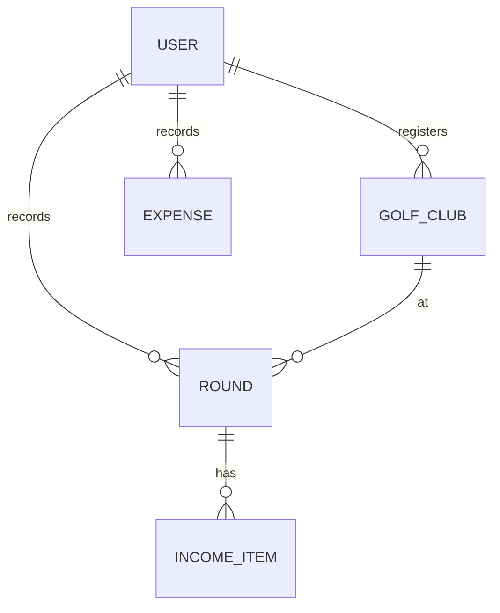

# 데이터 모델

> 상태: 미착수 (Phase 2에서 작성) · 최종 수정일: 2026-11-26
> 선행 조건: Q-002, Q-003, Q-008 해결 / 용어는 `../00-overview/glossary.md`의 영문 코드명을 따른다.

## 1. ERD (초안 아이디어 — 확정 아님)

## 2. 엔티티 정의
### ROUND
| 컬럼 | 타입 | 필수 | 설명 | 관련 요구사항 |
|---|---|---|---|---|
| id | TODO | Y | | |
| date | date | Y | 근무일 | FR-001 |
| ... | | | | |

> TODO: 엔티티별로 표 작성

## 3. 설계 원칙
- 금액: 원 단위 정수 (NFR-005)
- 삭제: TODO (소프트 삭제 여부 결정 → ADR)

## 변경 이력
- 2026-11-26 틀 생성
