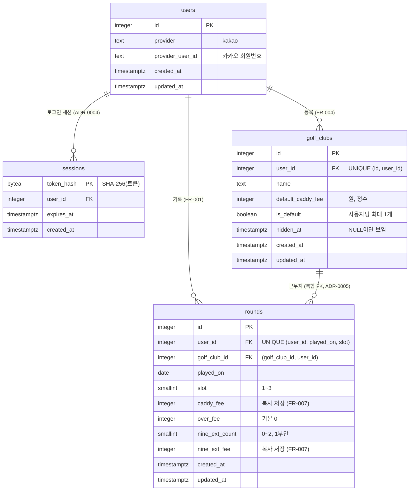

# 데이터 모델

> 상태: **확정** · 최종 수정일: 2026-11-27
> 선행 조건: SRS Must 확정, `architecture.md`(검토중), ADR-0004 세션, ADR-0005 데이터 분리
> 관련 결정: **ADR-0003 ORM = Drizzle** · ADR-0005 복합 FK
> 용어는 `../00-overview/glossary.md`의 영문 코드명을 따른다. 테이블·컬럼은 `snake_case`, 코드는 `camelCase`.

이 문서의 SQL은 **PostgreSQL 17 기준 목표 스키마**다. 구현은 Drizzle 스키마(`apps/api/src/database/schema.ts`)로 이 DDL을 그대로 옮기고, `drizzle-kit generate`가 만든 SQL 마이그레이션이 §4와 같은지 리뷰한다(ADR-0003).

---

## 1. ERD



**관계 요약**

| 관계 | 종류 | FK | 삭제 시 | 근거 |
|---|---|---|---|---|
| users → sessions | 1:N | `sessions.user_id → users.id` | CASCADE | ADR-0004, FR-041(Should) |
| users → golf_clubs | 1:N | `golf_clubs.user_id → users.id` | CASCADE | NFR-003, FR-041 |
| users → rounds | 1:N | `rounds.user_id → users.id` | CASCADE | NFR-003, FR-041 |
| golf_clubs → rounds | 1:N | `rounds (golf_club_id, user_id) → golf_clubs (id, user_id)` **복합 FK** | **RESTRICT** | ADR-0005, Q-018 |

- 복합 FK 덕분에 **내 라운드에 남의 골프장을 연결할 수 없다** (코드 버그가 있어도 DB가 거부, AC-N003-1).
- `RESTRICT` 덕분에 **라운드가 있는 골프장은 DB에서 물리 삭제가 불가능**하다. 서비스는 이 경우 숨기기(`hidden_at`)로 처리한다(Q-018, AC-004-4). 계정 삭제(FR-041)는 `users` 삭제 → `rounds`·`golf_clubs` 모두 CASCADE이므로 막히지 않는다.

> 지출(EXPENSE)·수입 항목(INCOME_ITEM) 테이블은 만들지 않는다. 지출은 Won't(FR-020), 수입 항목은 캐디피·나인추가·오버피 세 가지로 고정이라 컬럼으로 충분하다(Q-002, FR-008).

---

## 2. 공통 규칙

| 규칙 | 내용 | 근거 |
|---|---|---|
| 금액 타입 | 모든 금액은 `integer`(원 단위). `numeric`·`real`·`double`·`money` 금지. 상한 1,000,000원이라 int4로 충분 | NFR-005, AC-N005-1 |
| 금액 범위 | DB `CHECK`로 SRS 공통 입력 규칙의 범위를 그대로 강제 (서버 DTO 검증 + DB 이중 방어) | NFR-005, SRS §5 공통 입력 규칙 |
| 사용자 소유 | 사용자 데이터 테이블(`golf_clubs`, `rounds`, `sessions`)은 모두 `user_id integer NOT NULL` | NFR-003, ADR-0005 |
| 인덱스 | 사용자 소유 테이블의 조회용 인덱스는 `user_id`로 시작 | NFR-003, NFR-002 |
| PK | `integer GENERATED ALWAYS AS IDENTITY`. 사용자 10명 규모라 int4로 충분하고, JS `number`·브랜드 타입 `UserId = number`(architecture §3.3)와 그대로 맞는다. ID 추측은 `WHERE id AND user_id` + 404로 무력화된다 | ADR-0005 |
| 시각 | `timestamptz`, 기본값 `now()`. `updated_at`은 애플리케이션(ORM)에서 갱신 | — |
| 날짜 | 근무일은 `date`(시간·시간대 없음). 사용자가 고른 날짜를 그대로 저장한다. "오늘"은 클라이언트가 KST로 계산 | FR-001, Q-019 |
| 삭제 | 라운드는 **물리 삭제**(확인 창 후, AC-003-3). 골프장은 라운드가 있으면 숨기기, 없으면 물리 삭제(AC-004-4·6). 실수 복구는 백업으로(ADR-0006) | Q-018, Q-020 |
| 이름 규칙 | 테이블은 복수형 `snake_case`. 금액 컬럼은 `*_fee`, 횟수는 `*_count` | glossary |

---

## 3. 엔티티 정의

### 3.1 `users` — 사용자 (User)

| 컬럼 | 타입 | NULL | 기본값 | 제약 | 설명 | 관련 요구사항 |
|---|---|---|---|---|---|---|
| id | integer | N | identity | PK | 사용자 ID. 세션에서만 얻는다 (`UserId` 브랜드 타입) | NFR-003, ADR-0005 |
| provider | text | N | `'kakao'` | `CHECK (provider = 'kakao')` | 로그인 제공자. 지금은 카카오뿐 | FR-040, Q-011 |
| provider_user_id | text | N | | `UNIQUE (provider, provider_user_id)` | 카카오 회원번호(64비트 정수, 문자열로 저장). 재로그인 시 같은 계정을 찾는 키 | FR-040, AC-040-1·2 |
| created_at | timestamptz | N | `now()` | | 가입 시각 | — |
| updated_at | timestamptz | N | `now()` | | 수정 시각 | — |

- 이름·이메일·프로필 등 **개인정보 컬럼은 없다**. 카카오 동의 항목을 요청하지 않는다(architecture §4.1).
- 카카오 access token은 저장하지 않는다(ADR-0004).
- **기본 골프장은 `users`가 아니라 `golf_clubs.is_default`에 둔다** (§3.3 아래 "설계 선택" 참고).

### 3.2 `sessions` — 로그인 세션 (ADR-0004)

| 컬럼 | 타입 | NULL | 기본값 | 제약 | 설명 | 관련 요구사항 |
|---|---|---|---|---|---|---|
| token_hash | bytea | N | | PK, `CHECK (octet_length(token_hash) = 32)` | 쿠키 토큰의 SHA-256 해시. 원본 토큰은 저장하지 않음 | FR-040, ADR-0004 |
| user_id | integer | N | | FK → `users.id` ON DELETE CASCADE | 세션 주인 | FR-040, NFR-003 |
| expires_at | timestamptz | N | | | 만료 시각. 30일, 남은 기간 15일 미만이면 연장(슬라이딩) | FR-040, ADR-0004 |
| created_at | timestamptz | N | `now()` | | 발급 시각 | ADR-0004 |

- 인덱스: `sessions_user_id_idx (user_id)` — 로그인 시 그 사용자의 만료 세션 삭제, 계정 삭제 CASCADE.
- **NFR-003 예외**: 이 테이블만 `user_id` 없이 `token_hash`로 조회한다(아직 사용자를 모르는 단계). 이 조회는 `SessionRepository` 한 곳에만 둔다(architecture §3.3).
- 로그아웃(AC-040-3)은 행 삭제.

### 3.3 `golf_clubs` — 골프장 (GolfClub)

| 컬럼 | 타입 | NULL | 기본값 | 제약 | 설명 | 관련 요구사항 |
|---|---|---|---|---|---|---|
| id | integer | N | identity | PK, **`UNIQUE (id, user_id)`** | 골프장 ID. `(id, user_id)` 유니크는 복합 FK의 참조 대상 | FR-004, ADR-0005 |
| user_id | integer | N | | FK → `users.id` ON DELETE CASCADE | 소유 사용자. 골프장 목록도 사용자별로 분리 | **NFR-003**, Q-016, AC-004-7 |
| name | text | N | | `CHECK (length(btrim(name)) BETWEEN 1 AND 50)`, 보이는 골프장끼리 이름 중복 금지(아래) | 골프장 이름. 앞뒤 공백 제거 후 저장 | FR-004, AC-004-1·2 |
| default_caddy_fee | integer | N | | `CHECK (default_caddy_fee BETWEEN 1 AND 1000000)` | 기본 캐디피(원). 라운드 입력 시 자동 채움에만 쓰고, 지난 라운드에는 영향 없음 | FR-006, **FR-007**, **NFR-005** |
| is_default | boolean | N | `false` | 사용자당 최대 1개(부분 유니크 인덱스) | 기본 골프장 여부 | FR-004, AC-004-3 |
| hidden_at | timestamptz | **Y** | NULL | `CHECK (NOT (is_default AND hidden_at IS NOT NULL))` | 숨긴 시각. NULL = 보임. 숨긴 골프장은 목록·입력 선택지에서 빠지고 지난 라운드에는 이름이 그대로 보임 | FR-004, **Q-018**, AC-004-4·5 |
| created_at | timestamptz | N | `now()` | | | — |
| updated_at | timestamptz | N | `now()` | | | — |

**인덱스·제약**

| 이름 | 정의 | 목적 | 관련 |
|---|---|---|---|
| `golf_clubs_id_user_id_key` | `UNIQUE (id, user_id)` | 복합 FK 참조 대상 | ADR-0005 |
| `golf_clubs_one_default_per_user` | `UNIQUE (user_id) WHERE is_default` (부분 유니크) | 기본 골프장은 한 번에 하나 | AC-004-3 |
| `golf_clubs_user_visible_name_key` | `UNIQUE (user_id, name) WHERE hidden_at IS NULL` (부분 유니크) | 보이는 골프장끼리 같은 이름 금지. 숨긴 골프장과 같은 이름으로 새로 추가하는 것은 허용 | AC-004-2, **Q-026** |
| `golf_clubs_user_id_idx` | (위 유니크 인덱스가 `user_id`로 시작하므로 별도 불필요) | 목록 조회 | NFR-003 |

**설계 선택: 기본 골프장을 어디에 둘까**

| 방식 | 장점 | 단점 |
|---|---|---|
| **A. `golf_clubs.is_default` + 부분 유니크 인덱스 (채택)** | FK 순환 없음. "숨긴 골프장은 기본일 수 없다"(AC-004-5)를 `CHECK` 하나로 DB에서 강제 | 기본 변경 시 한 트랜잭션에서 기존 것 `false` → 새 것 `true` 두 번 갱신 |
| B. `users.default_golf_club_id` FK | 한 행만 바꾸면 됨 | `users ↔ golf_clubs` 순환 참조. 남의 골프장을 가리키지 않게 하려면 또 복합 FK 필요. 숨김과의 관계를 DB로 못 막음 |

**동작 규칙 (Service, 트랜잭션 하나)**
- 기본 지정(AC-004-3): `UPDATE … SET is_default = false WHERE user_id = $1 AND is_default` → `UPDATE … SET is_default = true WHERE id = $2 AND user_id = $1 AND hidden_at IS NULL` (0행이면 404).
- 삭제 요청(AC-004-4~6): 그 골프장에 라운드가 있으면 `hidden_at = now(), is_default = false`, 없으면 `DELETE`. 동시에 라운드가 생기는 경쟁 상황에서도 `DELETE`는 복합 FK `RESTRICT`에 막혀 실패하므로, FK 위반 오류를 잡아 숨기기로 다시 처리한다.
- 숨긴 골프장 되살리기는 요구사항에 없으므로 만들지 않는다.
- Q-026: 숨긴 "OO CC"가 있어도 새 "OO CC"를 추가할 수 있다. 이 경우 지난 라운드 목록·통계에 같은 이름이 두 골프장으로 나뉘어 보일 수 있다(사용자 승인, 2026-11-27).
- 골프장 이름 변경 시 지난 라운드에도 새 이름이 보인다(라운드는 `golf_club_id`로 참조, 이름은 복사하지 않음). FR-007은 **금액**만 보존을 요구한다.

### 3.4 `rounds` — 라운드 (Round)

| 컬럼 | 타입 | NULL | 기본값 | 제약 | 설명 | 관련 요구사항 |
|---|---|---|---|---|---|---|
| id | integer | N | identity | PK | 라운드 ID | FR-001, FR-003 |
| user_id | integer | N | | FK → `users.id` ON DELETE CASCADE | 소유 사용자 | **NFR-003**, ADR-0005 |
| golf_club_id | integer | N | | **복합 FK `(golf_club_id, user_id)` → `golf_clubs (id, user_id)` ON DELETE RESTRICT** | 근무한 골프장. 같은 사용자의 골프장만 가능. 숨김 여부는 Service가 검사(숨긴 골프장으로 새로 등록·변경 불가, 기존 라운드는 유지) | FR-001, FR-004, **Q-018**, ADR-0005 |
| played_on | date | N | | `UNIQUE (user_id, played_on, slot)` | 근무일. 과거·오늘·미래 모두 허용 | FR-001, FR-005, Q-019, AC-001-4 |
| slot | smallint | N | | `CHECK (slot BETWEEN 1 AND 3)` | 부 (1부/2부/3부) | FR-005, Q-014 |
| caddy_fee | integer | N | | `CHECK (caddy_fee BETWEEN 1 AND 1000000)` | 캐디피(원). **입력 당시 금액을 복사 저장** — 골프장 기본 캐디피를 바꿔도 그대로 | FR-001, FR-006, **FR-007**, **NFR-005**, AC-001-3, AC-007-1 |
| over_fee | integer | N | `0` | `CHECK (over_fee BETWEEN 0 AND 1000000)` | 오버피(원). 비우면 0 | FR-002, **NFR-005**, AC-002-1·3 |
| nine_ext_count | smallint | N | `0` | `CHECK (nine_ext_count BETWEEN 0 AND 2)` + `CHECK (slot = 1 OR nine_ext_count = 0)` | 나인추가 횟수. 1부일 때만 1 이상 | **FR-008**, Q-022, Q-023, AC-008-6·7·10 |
| nine_ext_fee | integer | N | `0` | `CHECK ((nine_ext_count = 0 AND nine_ext_fee = 0) OR (nine_ext_count >= 1 AND nine_ext_fee BETWEEN 1 AND 1000000))` | 나인추가 금액(원, 정수). 기본값 ⌊캐디피 ÷ 2⌋ × 횟수를 **저장 시점에 계산해 복사 저장**, 직접 수정 가능 | **FR-008**, **FR-007**, **NFR-005**, Q-021, AC-007-3, AC-008-1·4·8·9 |
| created_at | timestamptz | N | `now()` | | | — |
| updated_at | timestamptz | N | `now()` | | | — |

**인덱스·제약**

| 이름 | 정의 | 목적 | 관련 |
|---|---|---|---|
| `rounds_user_date_slot_key` | `UNIQUE (user_id, played_on, slot)` | 같은 사용자·같은 날짜·같은 부 중복 금지. 위반 시 `DuplicateRoundError` → 409 | **Q-017**, AC-003-2, AC-005-3 |
| (위 인덱스 재사용) | `user_id, played_on` 앞부분 | 월·연 범위 조회(`played_on >= 월초 AND < 다음 달 초`), 달력, CSV | FR-010, FR-011, NFR-002 |
| `rounds_club_user_fk` | `FOREIGN KEY (golf_club_id, user_id) REFERENCES golf_clubs (id, user_id) ON DELETE RESTRICT` | 남의 골프장 연결 차단, 라운드 있는 골프장 삭제 차단 | ADR-0005, Q-018, AC-N003-1 |
| `rounds_golf_club_idx` | `(golf_club_id, user_id)` | "이 골프장에 라운드가 있나" 확인(숨기기 판단), FK 검사 성능 | AC-004-4·6 |
| `rounds_slot_check` 외 CHECK 4개 | 위 표 | 금액·횟수·부 규칙을 DB에서도 강제 | FR-008, NFR-005 |

**FR-007을 어떻게 만족하나 (금액 복사 저장)**
- `rounds.caddy_fee`·`nine_ext_fee`는 **골프장의 `default_caddy_fee`를 참조하지 않는 독립 값**이다. 기본 캐디피는 입력 폼을 미리 채우는 데만 쓴다(FR-006).
- 골프장 기본 캐디피 수정 API는 `golf_clubs` 한 행만 바꾸고 `rounds`는 건드리지 않는다. 테스트: AC-007-1·2·3.
- 통계는 `rounds`의 저장값만 더한다 → 기본 캐디피를 바꿔도 지난 통계가 바뀌지 않는다.

**나인추가 금액을 "직접 고쳤는지"는 저장하지 않는다**
- AC-008-5의 "직접 고친 뒤에는 자동으로 바뀌지 않음"은 **입력 폼 상태**다. 저장된 라운드를 다시 열 때는 `nine_ext_fee ≠ ⌊caddy_fee ÷ 2⌋ × nine_ext_count`이면 "직접 고친 값"으로 보고 자동 재계산을 끈다. 둘이 같으면 고쳤든 안 고쳤든 결과가 같으므로 구분할 필요가 없다. (계산식은 `packages/shared` 한 곳, architecture §3.2)

**부를 바꿀 때 (AC-008-7)**: 나인추가가 있는 1부를 2·3부로 바꾸면 Service가 먼저 422("나인추가는 1부에만 기록할 수 있습니다")로 거부한다. Service를 빠뜨려도 `CHECK (slot = 1 OR nine_ext_count = 0)`가 막는다.

---

## 4. 목표 DDL (PostgreSQL 17)

ORM 스키마와 마이그레이션은 결과적으로 이 DDL과 같아야 한다. 마이그레이션 검증 테스트에서 실제 DB의 제약 목록과 비교한다(Phase 3).

```sql
-- users (FR-040)
CREATE TABLE users (
  id               integer GENERATED ALWAYS AS IDENTITY PRIMARY KEY,
  provider         text        NOT NULL DEFAULT 'kakao' CHECK (provider = 'kakao'),
  provider_user_id text        NOT NULL,
  created_at       timestamptz NOT NULL DEFAULT now(),
  updated_at       timestamptz NOT NULL DEFAULT now(),
  CONSTRAINT users_provider_user_key UNIQUE (provider, provider_user_id)  -- AC-040-2
);

-- sessions (ADR-0004)
CREATE TABLE sessions (
  token_hash bytea       PRIMARY KEY CHECK (octet_length(token_hash) = 32),
  user_id    integer     NOT NULL REFERENCES users (id) ON DELETE CASCADE,
  expires_at timestamptz NOT NULL,
  created_at timestamptz NOT NULL DEFAULT now()
);
CREATE INDEX sessions_user_id_idx ON sessions (user_id);

-- golf_clubs (FR-004, FR-006, Q-018)
CREATE TABLE golf_clubs (
  id                integer GENERATED ALWAYS AS IDENTITY PRIMARY KEY,
  user_id           integer     NOT NULL REFERENCES users (id) ON DELETE CASCADE,  -- NFR-003
  name              text        NOT NULL CHECK (length(btrim(name)) BETWEEN 1 AND 50),
  default_caddy_fee integer     NOT NULL CHECK (default_caddy_fee BETWEEN 1 AND 1000000), -- NFR-005
  is_default        boolean     NOT NULL DEFAULT false,
  hidden_at         timestamptz,
  created_at        timestamptz NOT NULL DEFAULT now(),
  updated_at        timestamptz NOT NULL DEFAULT now(),
  CONSTRAINT golf_clubs_id_user_id_key UNIQUE (id, user_id),                  -- ADR-0005
  CONSTRAINT golf_clubs_hidden_not_default CHECK (NOT (is_default AND hidden_at IS NOT NULL)) -- AC-004-5
);
CREATE UNIQUE INDEX golf_clubs_one_default_per_user ON golf_clubs (user_id) WHERE is_default; -- AC-004-3
CREATE UNIQUE INDEX golf_clubs_user_visible_name_key ON golf_clubs (user_id, name)
  WHERE hidden_at IS NULL;                                                     -- AC-004-2, Q-026

-- rounds (FR-001~008)
CREATE TABLE rounds (
  id             integer GENERATED ALWAYS AS IDENTITY PRIMARY KEY,
  user_id        integer     NOT NULL REFERENCES users (id) ON DELETE CASCADE,     -- NFR-003
  golf_club_id   integer     NOT NULL,
  played_on      date        NOT NULL,
  slot           smallint    NOT NULL CHECK (slot BETWEEN 1 AND 3),                -- FR-005
  caddy_fee      integer     NOT NULL CHECK (caddy_fee BETWEEN 1 AND 1000000),     -- FR-007 복사 저장
  over_fee       integer     NOT NULL DEFAULT 0 CHECK (over_fee BETWEEN 0 AND 1000000), -- FR-002
  nine_ext_count smallint    NOT NULL DEFAULT 0 CHECK (nine_ext_count BETWEEN 0 AND 2), -- FR-008
  nine_ext_fee   integer     NOT NULL DEFAULT 0,
  created_at     timestamptz NOT NULL DEFAULT now(),
  updated_at     timestamptz NOT NULL DEFAULT now(),
  CONSTRAINT rounds_user_date_slot_key UNIQUE (user_id, played_on, slot),          -- Q-017
  CONSTRAINT rounds_club_user_fk FOREIGN KEY (golf_club_id, user_id)
    REFERENCES golf_clubs (id, user_id) ON DELETE RESTRICT,                        -- ADR-0005, Q-018
  CONSTRAINT rounds_nine_ext_slot1_only CHECK (slot = 1 OR nine_ext_count = 0),    -- AC-008-7
  CONSTRAINT rounds_nine_ext_fee_consistent CHECK (
    (nine_ext_count = 0 AND nine_ext_fee = 0)
    OR (nine_ext_count >= 1 AND nine_ext_fee BETWEEN 1 AND 1000000)              -- AC-008-8, NFR-005
  )
);
CREATE INDEX rounds_golf_club_idx ON rounds (golf_club_id, user_id);
```

---

## 5. 파생 값 · 집계 (저장하지 않는 것)

저장은 정수 원본만 하고, 아래 값은 조회할 때 계산한다(SRS 공통 입력 규칙 "표시할 때만 계산").

| 값 | 계산 | 관련 |
|---|---|---|
| 라운드 수입 | `caddy_fee + nine_ext_fee + over_fee` | FR-008, glossary RoundIncome |
| 반 라운드 수 (half units) | `2 + nine_ext_count` | Q-024 |
| 환산 라운드 수 | `SUM(2 + nine_ext_count) / 2` — 표시할 때만 나눔 (예: 5 → "2.5") | FR-011, AC-011-5 |
| 라운드당 평균 | `round(SUM(수입) × 2 / SUM(2 + nine_ext_count))`, 원 단위 반올림. 라운드 0건이면 계산하지 않고 "-" | FR-011, AC-011-2·3·5, NFR-005 |
| 나인추가 횟수 합계 | `SUM(nine_ext_count)` | FR-011 |

- **부동소수를 쓰지 않는다.** 환산 라운드 수를 "반 라운드" 정수로 다뤄 0.5 곱셈을 없앤다(AC-011-5: 840,000 ÷ 5 = 168,000). 반올림은 정수 연산 `(2a + b) div (2b)`로 구현하고 `packages/shared`에 둔다.
- PostgreSQL `SUM(integer)`의 결과는 `bigint`이고, node-postgres는 `bigint`를 **문자열**로 돌려준다. 연간 합계도 int4 범위(약 21억)를 넘을 수 있으므로, 집계 결과는 문자열로 받아 `Number()`로 바꾸되 `Number.isSafeInteger`를 확인한다(이 규모에서는 안전).
- 모든 집계 쿼리에 `WHERE user_id = $1`을 넣는다 (AC-N003-2, architecture §3.3 체크리스트).

**대표 쿼리 (월 통계, FR-011)**
```sql
SELECT
  COALESCE(SUM(caddy_fee), 0)                         AS caddy_fee_total,
  COALESCE(SUM(nine_ext_fee), 0)                      AS nine_ext_fee_total,
  COALESCE(SUM(over_fee), 0)                          AS over_fee_total,
  COALESCE(SUM(caddy_fee + nine_ext_fee + over_fee), 0) AS income_total,
  COALESCE(SUM(nine_ext_count), 0)                    AS nine_ext_count_total,
  COALESCE(SUM(2 + nine_ext_count), 0)                AS half_round_units
FROM rounds
WHERE user_id = $1                                     -- NFR-003
  AND played_on >= $2 AND played_on < $3;              -- 월초 ~ 다음 달 초 (미래 날짜 포함, AC-011-4)
```

---

## 6. 요구사항 → 데이터 모델 추적

| 요구사항 | 데이터 모델에서 만족하는 방법 |
|---|---|
| FR-001 | `rounds` 필수 컬럼(날짜·부·골프장·캐디피) NOT NULL |
| FR-002 | `rounds.over_fee DEFAULT 0` + 범위 CHECK |
| FR-003 | `WHERE id AND user_id` 수정·물리 삭제 |
| FR-004 | `golf_clubs`, `is_default` 부분 유니크, `hidden_at`, 보이는 골프장끼리 이름 유니크(Q-026) |
| FR-005 | `slot` 1~3 CHECK, `UNIQUE (user_id, played_on, slot)` |
| FR-006 | `golf_clubs.default_caddy_fee` |
| **FR-007** | `rounds.caddy_fee`·`nine_ext_fee` 복사 저장, 골프장 기본값과 독립 |
| **FR-008** | `nine_ext_count` 0~2, 1부만 CHECK, `nine_ext_fee` 정수·일관성 CHECK |
| FR-010, FR-011 | §5 집계, `(user_id, played_on, …)` 인덱스 |
| FR-040 | `users (provider, provider_user_id)` 유니크, `sessions` |
| FR-041 (Should) | `users` 삭제 시 모든 소유 데이터 CASCADE |
| **NFR-003** | 모든 사용자 데이터 테이블 `user_id NOT NULL`, 복합 FK, 인덱스가 `user_id`로 시작 |
| NFR-004 | 물리 삭제는 확인 후에만, 백업은 ADR-0006 |
| **NFR-005** | 모든 금액 `integer` + 범위 CHECK, §5 정수 집계 |
| **Q-017** | `rounds_user_date_slot_key` |
| **Q-018** | `hidden_at` + 복합 FK `ON DELETE RESTRICT` |

---

## 7. 테스트 연결 (→ `04-test/test-plan.md` §3으로 옮김, 2026-11-27. 이후 변경은 test-plan에서)

| 테스트 | 수준 | 검증 | AC |
|---|---|---|---|
| 중복 라운드 | 통합 (실제 PG) | 같은 `(user_id, played_on, slot)` 두 번 insert → 유니크 위반 → 409 | AC-005-3, AC-003-2 |
| 다른 사용자는 같은 날짜·부 가능 | 통합 | A와 B가 같은 날짜 1부 각각 저장 → 둘 다 성공 | AC-005-3, NFR-003 |
| 나인추가 CHECK | 통합 | 2부 + 횟수 1, 횟수 3, 횟수 1 + 금액 0, 횟수 0 + 금액 1 → 모두 CHECK 위반 | AC-008-7·8·10 |
| 금액 CHECK | 통합 | 캐디피 0·1,000,001, 오버피 -1 → CHECK 위반 | AC-001-3, AC-002-3 |
| 기본 캐디피 변경 | E2E | 라운드 10건 후 골프장 기본값 변경 → 라운드 금액·월 통계 불변 | AC-007-1·2·3 |
| 복합 FK | 통합 | B의 라운드에 A의 `golf_club_id` → FK 위반 | AC-N003-1 |
| 골프장 삭제/숨기기 | 통합 | 라운드 있는 골프장 `DELETE` → RESTRICT 위반 / Service는 숨기기 | AC-004-4·6 |
| 골프장 이름 중복 | 통합 | 보이는 "OO CC" 두 개 → 유니크 위반 / 숨긴 "OO CC" + 새 "OO CC" → 성공 | AC-004-2, Q-026 |
| 기본 골프장 하나 | 통합 | 같은 사용자 `is_default = true` 두 개 → 유니크 위반, 숨긴 골프장 기본 지정 → CHECK 위반 | AC-004-3·5 |
| 정수 집계 | 단위 + 통합 | AC-011-1·5 예시 데이터로 합계·평균 정확히 일치 | AC-011-1·3·5, AC-N005-2 |
| 스키마 일치 | 통합 | 마이그레이션 후 `pg_constraint`·`pg_indexes`에 §4의 제약 이름이 모두 있는지 확인 (ORM이 CHECK를 빠뜨리는 것 방지) | NFR-005, ADR-0003 |

## 변경 이력
- 2026-11-26 틀 생성
- 2026-11-27 ERD·엔티티 정의·목표 DDL·집계·추적표 작성 → 상태 "검토중" (FR-007 금액 복사 저장, Q-017 유니크, Q-018 숨기기 + RESTRICT, FR-008 CHECK, ADR-0005 복합 FK, `users`·`sessions`). Q-026 반영: 이름 유니크는 보이는 골프장끼리만. ORM은 Drizzle(ADR-0003)
- 2026-11-27 **확정** (사용자 승인, M1 설계 확정). 이후 변경은 이 이력에 기록한다
- 2026-11-27 §7 테스트 표를 `test-plan.md` §3(T-I01~10)으로 이관
- 2026-11-28 `users`·`sessions` 구현(Drizzle `apps/api/src/database/schema.ts`, 마이그레이션 `apps/api/drizzle/0000_init_users_sessions.sql`). DDL 변경 없음. 제약 이름은 PostgreSQL 기본 이름(`users_provider_check`, `sessions_token_hash_check`, `sessions_user_id_fkey`)으로 명시
