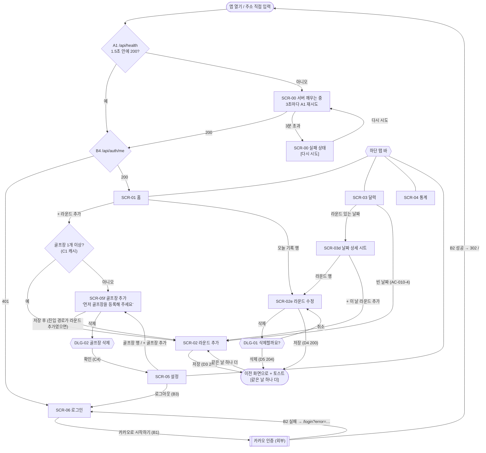
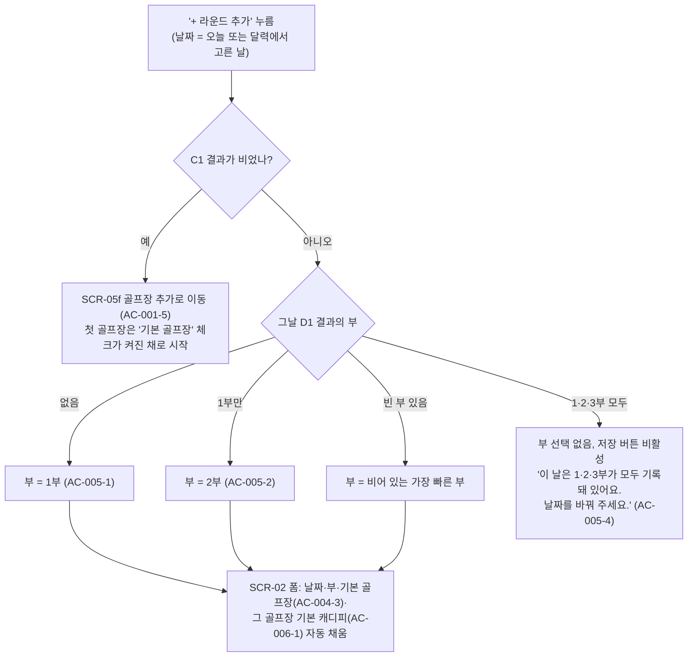
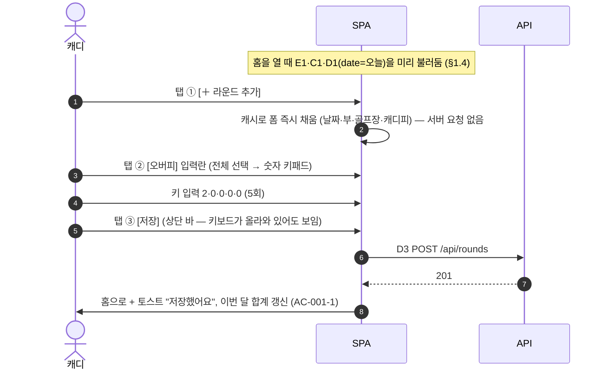

# UI 설계

> 상태: **확정** · 최종 수정일: 2026-11-27
> 선행 문서: SRS(Must 확정), `use-cases.md`(UC-01), `architecture.md` §5.3(서버 깨우기), `api-spec.md`(엔드포인트 ID `A1`~`F1`)
> 범위: Must 화면 전부 + Should 화면(연간 요약·CSV)은 자리만 표시. 시각 디자인(색·로고)은 구현 중에 다듬고, 이 문서는 **구조·동작·크기 규칙**을 정한다.

---

## 1. 공통 UI 규칙

### 1.1 크기 기준 (NFR-001)

| 항목 | 규칙 | 근거 |
|---|---|---|
| 기준 화면 | **폭 360px**, 높이 640px(작은 안드로이드)에서 설계. 그보다 넓으면 본문 폭을 최대 480px로 두고 가운데 정렬 | **AC-N001-1** |
| 좌우 여백 | 16px → 본문 폭 328px | AC-N001-1 |
| 가로 스크롤 | 어떤 화면도 `document.scrollingElement.scrollWidth ≤ 360`. 긴 골프장 이름은 말줄임(`text-overflow: ellipsis`), 금액은 줄바꿈 금지 영역 안에서만 | **AC-N001-1** |
| 누르는 요소 | 버튼·입력창·탭·달력 칸·목록 행·토글 **모두 최소 44×44px**. 아이콘 버튼도 눌리는 영역은 44px(아이콘 자체는 24px 가능) | **AC-N001-2** |
| 주요 버튼 | 높이 52px, 폭 100%(본문 폭) | AC-N001-2 |
| 입력창 | 높이 48px, 글자 16px 이상(iOS가 입력창 확대하지 않게) | AC-N001-2 |
| 요소 간격 | 누르는 요소끼리 최소 8px 간격(잘못 누름 방지) | AC-N001-2 |
| 하단 탭 바 | 높이 56px + 안전 영역(`env(safe-area-inset-bottom)`), 탭 4개 × 90px | AC-N001-2 |

### 1.2 입력·표시 규칙

| 항목 | 규칙 | 근거 |
|---|---|---|
| 금액 입력 | `inputmode="numeric"`(숫자 키패드), 숫자 외 문자는 입력 시 무시, 입력 중에도 천 단위 쉼표 표시, 뒤에 "원" 고정 글자. 값은 정수로만 보관 | NFR-005, architecture §6 |
| 금액 표시 | `160,000원`(`Intl.NumberFormat('ko-KR')`), 숫자는 `font-variant-numeric: tabular-nums` | NFR-005 |
| 달력 칸 금액 | 칸이 좁아(46px) **만 원 단위 축약** `26만`, `25.5만`(소수 첫째 자리까지, 버림). **정확한 금액은 날짜 상세·월 합계에서** 표시 | AC-010-1, AC-N001-1 |
| 환산 라운드 수 | `roundHalfUnits ÷ 2` → `2`, `1.5`, `2.5`(`packages/shared`의 `formatRoundCount`) | Q-024, api-spec §1.1 |
| 평균 없음 | `averageIncomePerRound = null` → `-` | AC-011-2 |
| 날짜 | 화면에는 `12월 3일 (수)`, 달력 제목은 `2026년 12월`. 기준 시간대는 한국(`Asia/Seoul`)으로 "오늘"을 계산 | FR-001 |
| 부 | `1부`·`2부`·`3부` 세그먼트 버튼(가로 3칸) | FR-005 |
| 오류 표시 | 입력란 **바로 아래** 빨간 글씨 + 입력란 테두리 빨강 + `aria-describedby`. 여러 칸이면 **모두** 동시에 표시하고 첫 오류 칸으로 스크롤·포커스 | **AC-001-2** |
| 성공 알림 | 화면 하단(탭 바 위) 토스트 3초. 저장은 서버 201/200을 받은 **뒤에만** "저장했어요" | AC-N004-1, NFR-004 |
| 진행 표시 | 요청이 0.3초 넘게 걸리면 누른 버튼 안에 스피너, 버튼 비활성(두 번 저장 방지) | architecture §5.3 |

### 1.3 서버 에러 → 화면 매핑 (ADR-0008)

SPA는 `error.code`로만 분기한다(메시지 문자열로 분기 금지). 문구는 서버 `message`를 그대로 쓰되, 아래 표의 화면 동작을 붙인다.

| 응답 | 화면 동작 | 관련 |
|---|---|---|
| 400 `VALIDATION_FAILED` | `fields[].field`에 맞는 입력란 아래에 `fields[].message` 표시. 맞는 칸이 없으면 폼 위 배너 | AC-001-2·3, AC-002-3, AC-008-10 |
| 401 `UNAUTHENTICATED` | 메모리 캐시 비우고 `/login`으로 `replace` 이동 | **AC-040-3·4** |
| 403 `FORBIDDEN_*` | 배너 "허용되지 않은 요청입니다. 앱을 새로고침해 주세요." | — |
| 404 `ROUND_NOT_FOUND` | 수정 화면이면 "라운드를 찾을 수 없어요" 빈 화면 + [달력으로] 버튼 | AC-N003-1 |
| 404 `GOLF_CLUB_NOT_FOUND` | 골프장 칸 아래 오류 + 골프장 목록(C1) 다시 불러오기 | AC-N003-1 |
| 409 `DUPLICATE_ROUND` | **부** 칸 아래 "이미 N부 기록이 있습니다." + 그날 기록(D1) 다시 불러와 사용 중인 부 표시 갱신 | **AC-005-3**, AC-003-2 |
| 409 `DUPLICATE_GOLF_CLUB_NAME` | 이름 칸 아래 오류 | **AC-004-2** |
| 422 `NINE_EXT_SLOT1_ONLY` | **부** 칸 아래 오류 | **AC-008-7** |
| 422 `GOLF_CLUB_HIDDEN` | 골프장 칸 아래 오류 + C1 다시 불러오기 | AC-004-4 |
| 500 / 네트워크 오류 | 폼 위 배너 "저장하지 못했어요. 다시 저장해 주세요." + 작은 글씨 `오류 번호 {requestId}`. **입력값은 그대로 유지**, 자동 재시도 없음 | UC-01 5b, NFR-008, architecture §5.3 |
| 502·503·504·시간 초과 | §4.1·§4.2 "서버 깨우는 중" 흐름 | NFR-002 |

### 1.4 데이터 캐시·미리 불러오기

- 서버 데이터는 **메모리 캐시에만** 둔다(로컬 저장소 금지, 로그아웃 시 전부 비움 — AC-040-3, architecture §4.3).
- 홈 화면을 열 때 **C1(골프장)·D1(`date=오늘`)을 함께 불러둔다** → "라운드 추가"를 누르면 서버 요청 없이 폼이 바로 채워진다(§3 30초 흐름).
- 저장·수정·삭제가 성공하면 그 달의 E1·D1(`month`)과 그날의 D1(`date`) 캐시를 무효화해 다시 불러온다 → 달력·통계에 즉시 반영(**AC-001-1**, AC-003-1·4).
- 캐시는 **TanStack Query**(메모리 캐시만, persister 없음), 라우터는 React Router, 스타일은 vanilla-extract, 시트·대화상자는 Radix Dialog로 정했다(**ADR-0009**, 2026-11-27 개정: vaul 제외). 쿼리 키·무효화 규칙·재시도 기본값은 ADR-0009 "Query 기본값".

---

## 2. 화면 목록

| ID | 화면 | 주소 (SPA 라우트) | 관련 FR / NFR | 호출 API | 관련 UC |
|---|---|---|---|---|---|
| **SCR-00** | 서버 깨우는 중 (앱 시작) | 모든 주소의 첫 진입 | NFR-002 | A1 반복 → B4 | — |
| SCR-00o | 서버 깨우는 중 (사용 중 오버레이) | 현재 화면 위 | NFR-002 | A1 | — |
| **SCR-06** | 로그인 | `/login`, `/login?error=…` | FR-040 | B1(페이지 이동) | UC-00 |
| **SCR-01** | 홈 (이번 달 요약·오늘 기록) | `/` | FR-011(요약), FR-001 진입 | E1(`month`), C1, D1(`date`) | UC-01, UC-04 |
| **SCR-02** | 라운드 추가 | `/rounds/new?date=YYYY-MM-DD` | FR-001, 002, 005, 006, 008 | C1, D1(`date`), D3 | UC-01 |
| SCR-02e | 라운드 수정 | `/rounds/:id` | FR-003, 005, 008 | D2, C1, D1(`date`), D4, D5 | UC-02 |
| **SCR-03** | 달력 | `/calendar?month=YYYY-MM` | FR-010 | E1(`month`), D1(`month`) | UC-03 |
| SCR-03d | 날짜 상세 (바텀 시트) | `/calendar?month=…&date=…` | FR-010, FR-005 | (SCR-03 캐시 사용) | UC-03, UC-02 |
| **SCR-04** | 통계 | `/stats?month=YYYY-MM` | FR-011 (+ Should FR-012·030·031) | E1(`month`) (+ Should E2, F1) | UC-04, UC-06 |
| **SCR-05** | 설정 (골프장 목록·계정) | `/settings` | FR-004, FR-006, FR-040 | C1, B3 | UC-07, UC-00 |
| SCR-05f | 골프장 추가·수정 | `/settings/golf-clubs/new`, `/settings/golf-clubs/:id` | FR-004, 006, 007 | C1(캐시), C2, C3, C4 | UC-07 |
| DLG-01 | 라운드 삭제 확인 창 | (모달) | FR-003 | D5 | UC-02 |
| DLG-02 | 골프장 삭제 확인 창 | (모달) | FR-004 | C4 | UC-07 |

- 하단 탭 바(홈·달력·통계·설정)는 SCR-01·03·04·05에만 보인다. 입력·수정 화면(SCR-02, 02e, 05f)은 탭 바 없이 상단 [←] 뒤로 가기 + 오른쪽 [저장]을 쓴다.
- SCR-05f `:id` 화면은 C1 캐시 값으로 그린다(골프장 단건 API 없음, api-spec §4). 캐시에 없는 ID면 C1을 다시 불러오고, 그래도 없으면 "골프장을 찾을 수 없어요" + [설정으로].
- 로그인하지 않은 상태로 `/login` 외 주소에 들어오면 B4가 401 → `/login`(**AC-040-4**). 로그인한 상태로 `/login`에 오면 `/`로.

---

## 3. 화면 흐름도

### 3.1 전체 흐름



### 3.2 "라운드 추가"를 눌렀을 때의 분기 (AC-001-5, AC-005-1·2·4)



---

## 4. 화면별 와이어프레임

> 그림의 폭은 360px 화면(좌우 여백 16px, 본문 328px)을 글자 폭으로 줄여 그렸다. `[ ]`는 누르는 요소, 옆의 `(44)`·`(52)` 등은 높이(px)다. 표시가 없는 누르는 요소도 최소 44×44px이다(AC-N001-2).

### 4.1 SCR-00 서버 깨우는 중 (앱 시작) — NFR-002 예외

- 관련: **NFR-002**(콜드 스타트 예외), ADR-0002, architecture §5.3 · API: **A1** `GET /api/health`(요청당 제한 8초, 3초 간격, 최대 3분) → 200이면 **B4**
- **1.5초 안에 A1이 오면 이 화면을 그리지 않는다**(깜빡임 없음). 그동안은 빈 배경 + 앱 이름만.

```
┌────────────────────────────────────┐ 360
│                                    │
│                                    │
│              캐디 수입              │  ← 앱 이름
│                                    │
│               ◜◝                   │  ← 회전 표시 (움직임 줄이기 설정 시 점 3개 깜빡임 없이 정지)
│               ◟◞                   │
│                                    │
│        서버를 깨우는 중이에요         │  ← 제목 20px, aria-live="polite"
│                                    │
│   무료 서버라 한동안 안 쓰면 잠들어요.   │  ← 설명 15px
│   보통 1분 안에 깨어나요.             │
│                                    │
│   ▓▓▓▓▓▓▓▓░░░░░░░░░░░░░░  0:34      │  ← 경과 시간 (1분 기준 진행 막대, 1분 넘으면 막대는 계속 흐름)
│                                    │
│                                    │
│   (1분이 지나면 추가 문구)            │
│   조금 더 걸리고 있어요.              │
│   창을 닫지 말고 기다려 주세요.        │
│                                    │
└────────────────────────────────────┘
```

**실패 상태 (3분 초과)**

```
┌────────────────────────────────────┐
│              캐디 수입              │
│                                    │
│               ⚠                    │
│        서버가 응답하지 않아요          │
│                                    │
│   잠시 후 다시 시도해 주세요.          │
│   계속 안 되면 인터넷 연결을 확인해     │
│   주세요.                           │
│                                    │
│  ┌──────────────────────────────┐  │
│  │          다시 시도             │  │ (52) → A1 재시작, 경과 시간 0부터
│  └──────────────────────────────┘  │
└────────────────────────────────────┘
```

| 상태 | 표시 | 다음 |
|---|---|---|
| 0 ~ 1.5초 | 빈 화면(앱 이름) | A1 200 → B4 |
| 1.5초 ~ 1분 | 위 화면, 경과 시간 | A1 200 → B4 → 홈 또는 로그인 |
| 1분 ~ 3분 | "조금 더 걸리고 있어요" 문구 추가 | 같음 |
| 3분 초과 | 실패 상태 + [다시 시도] | 버튼 → 처음부터 |
| 브라우저 오프라인(`navigator.onLine === false`) | "인터넷에 연결돼 있지 않아요" (재시도 중지, `online` 이벤트에 자동 재개) | NFR-008 |

- 이 대기 시간은 **AC-N001-3 30초 측정에서 뺀다**(Q-025).
- 깨어나기 전에는 로그인 버튼 등 서버가 필요한 버튼을 보여주지 않는다(architecture §5.3).

### 4.2 SCR-00o 서버 깨우는 중 (사용 중 오버레이)

- 관련: NFR-002, architecture §5.3 "사용 중 다시 잠듦" · API: A1
- 마지막 성공 응답에서 **14분 넘게 지난 뒤** 요청을 보낼 때, 먼저 A1을 보낸다. 1.5초 안에 응답이 없으면 현재 화면 위에 반투명 오버레이를 띄운다.

```
┌────────────────────────────────────┐
│ ← 라운드 추가                 저장   │  ← 뒤 화면 (흐리게, 입력값 그대로)
│░░░░░░░░░░░░░░░░░░░░░░░░░░░░░░░░░░░░│
│░░░┌────────────────────────────┐░░░│
│░░░│            ◜◝              │░░░│
│░░░│    서버를 깨우는 중이에요       │░░░│
│░░░│  깨어나면 자동으로 저장할게요.   │░░░│ ← 저장 요청이 기다리는 중일 때의 문구
│░░░│            0:21            │░░░│
│░░░│  ┌──────────────────────┐  │░░░│
│░░░│  │        취소           │  │░░░│ (44) → 오버레이 닫기, 저장 안 함, 입력값 유지
│░░░│  └──────────────────────┘  │░░░│
│░░░└────────────────────────────┘░░░│
│░░░░░░░░░░░░░░░░░░░░░░░░░░░░░░░░░░░░│
└────────────────────────────────────┘
```

- **저장 요청(D3·D4·D5·C2·C3·C4)은 A1이 200을 받은 뒤 한 번만 보낸다**(아직 보내지 않은 요청이므로 "자동 재시도"가 아님 → 사용자가 다시 누를 필요 없음). 이미 보낸 저장 요청이 502·503·504로 실패하면 자동 재전송하지 않고 "다시 저장" 배너(§1.3).
- 조회(GET)는 깨어난 뒤 1회 자동 재시도(architecture §5.3).
- 3분 초과 시 오버레이 안에 "서버가 응답하지 않아요" + [다시 시도] [닫기].

### 4.3 SCR-06 로그인 — FR-040

- 관련: **FR-040**, AC-040-1·2·3·4·5 · API: **B1** — `fetch`가 아니라 `location.href = '/api/auth/kakao/login'`(페이지 이동). 콜백(B2)은 서버가 처리해 `/` 또는 `/login?error=…`로 돌려보낸다.

```
┌────────────────────────────────────┐
│                                    │
│                                    │
│              캐디 수입              │  ← 앱 이름 28px
│                                    │
│     라운드마다 캐디피·오버피를 기록하고   │
│     월·연 수입을 한눈에 확인하세요.     │
│                                    │
│  ┌──────────────────────────────┐  │  ← 오류 배너 (error 쿼리가 있을 때만)
│  │ ⚠ 카카오 로그인을 취소했어요.     │  │
│  │   다시 시도해 주세요.           │  │
│  └──────────────────────────────┘  │
│                                    │
│                                    │
│  ┌──────────────────────────────┐  │
│  │ 💬     카카오 로그인            │  │ (52) 카카오 노란색 #FEE500, 카카오 디자인 가이드 따름
│  └──────────────────────────────┘  │
│                                    │
│   처음이면 자동으로 가입돼요.          │  ← 13px 회색 (AC-040-1)
│   이메일 등 개인정보는 받지 않아요.     │
└────────────────────────────────────┘
```

**`/login?error=` 값별 문구** (api-spec B2)

| `error` | 배너 문구 | 관련 |
|---|---|---|
| `cancelled` | 카카오 로그인을 취소했어요. 다시 시도해 주세요. | **AC-040-5** |
| `state` | 로그인 확인 시간이 지났어요. 다시 시도해 주세요. | CSRF 방어(state 불일치) |
| `kakao` | 카카오 연결에 문제가 있어요. 잠시 후 다시 시도해 주세요. | 카카오 토큰·조회 실패 |
| 그 밖의 값 | `kakao`와 같은 문구 | — |

- 배너를 보여준 뒤 주소에서 `error`를 지운다(`history.replaceState`) → 새로고침해도 다시 뜨지 않음.
- 버튼을 누르면 즉시 비활성 + "카카오로 이동 중…"(두 번 누름 방지).
- 로그아웃 뒤 이 화면은 `replace`로 들어오므로 뒤로 가기를 해도 데이터 화면이 나오지 않는다. 뒤로 가서 다시 그려지더라도 캐시가 비어 있고 API가 401 → 다시 이 화면(**AC-040-3**).

### 4.4 SCR-01 홈 — 이번 달 요약 · 오늘 기록

- 관련: FR-011(이번 달 요약), FR-001(라운드 추가 진입), FR-010 · API: **E1** `?month=이번 달`, **C1**, **D1** `?date=오늘`(셋을 동시에)

```
┌────────────────────────────────────┐
│ 12월                                │  ← 이번 달 (한국 시간 기준)
│                                    │
│ ┌────────────────────────────────┐ │  ← 요약 카드 전체가 눌림 → SCR-04 통계 (44 이상)
│ │ 이번 달 수입                     │ │
│ │ 420,000원                 ›    │ │  ← incomeTotal 28px
│ │ 2.5라운드 · 평균 168,000원       │ │  ← roundHalfUnits÷2, averageIncomePerRound (null이면 "-")
│ └────────────────────────────────┘ │
│                                    │
│ ┌────────────────────────────────┐ │
│ │        ＋  라운드 추가            │ │ (56) 주요 버튼, 화면에서 가장 큰 버튼
│ └────────────────────────────────┘ │
│                                    │
│ 오늘 12월 3일 (수)                   │
│ ┌────────────────────────────────┐ │
│ │ 1부  가나 CC          260,000원 │ │ (56) → SCR-02e
│ │      나인추가 1회 · 오버피 2만    │ │
│ ├────────────────────────────────┤ │
│ │ 2부  다라 GC          160,000원 │ │ (56) → SCR-02e
│ └────────────────────────────────┘ │
│  (오늘 기록이 없으면: "오늘 기록이 없어요")│
│                                    │
├────────────────────────────────────┤
│  [홈]    [달력]   [통계]   [설정]    │ (56) 탭 바
└────────────────────────────────────┘
```

| 상태 | 화면 | 관련 |
|---|---|---|
| 골프장 0개 (첫 로그인 직후) | 요약 카드 대신 안내 카드 "먼저 근무하는 골프장을 등록해 주세요" + [골프장 등록] (52). [라운드 추가]를 눌러도 SCR-05f로 | **AC-001-5** |
| 오늘 1·2·3부 모두 기록 | [라운드 추가]는 그대로 두고, 누르면 SCR-02가 "이 날은 모두 기록돼 있어요" 상태로 열림(날짜만 바꾸면 계속 입력 가능) | AC-005-4 |
| 불러오는 중 | 카드 자리에 회색 틀(스켈레톤). [라운드 추가]는 C1·D1이 오기 전까지 스피너 | NFR-002 |

### 4.5 SCR-02 라운드 추가 — FR-001·002·005·006·008

- 관련: **FR-001, FR-002, FR-005, FR-006, FR-008** · UC-01 · API: **C1**, **D1** `?date=`(날짜 바꿀 때마다), **D3** `POST /api/rounds`
- 진입: 홈 [라운드 추가](날짜 = 오늘), 달력 빈 날짜·[이 날 라운드 추가](날짜 = 그날), 저장 토스트의 [같은 날 하나 더].
- **저장 버튼이 두 곳**: 상단 오른쪽 [저장](키보드가 올라와도 항상 보임)과 폼 맨 아래 큰 [저장]. 숫자 키패드에는 완료 키가 없는 기기가 있어서다.

```
┌────────────────────────────────────┐
│ [←]  라운드 추가              [저장] │ (56) 상단 바. [←] 44×44, [저장] 64×44
├────────────────────────────────────┤
│ 날짜                 부              │
│ [12월 3일 (수) ▾]   [1부][2부][3부]  │ (48) 날짜 132px · 부 3칸×60px
│                         ·          │  ← 이미 기록된 부는 회색 + 점(눌리지 않음)
│ 골프장                              │
│ [가나 CC                       ▾]  │ (48) 기본 골프장 자동 선택 (AC-004-3)
│                                    │
│ 캐디피                              │
│ [               160,000 원]       │ (48) 골프장 기본 캐디피 자동 (AC-006-1·2)
│                                    │
│ 오버피 (선택)                        │
│ [                     0 원]       │ (48) 비우면 0원 (AC-002-1). 누르면 전체 선택돼 바로 덮어씀
│                                    │
│ 나인추가 (1부만)                     │
│ [없음][1회][2회]                    │ (44) 세그먼트 → 3회 이상은 고를 수 없음 (AC-008-10)
│                                    │
│ ┌────────────────────────────────┐ │
│ │ 이 라운드 수입        160,000원  │ │  ← 실시간 합계 (캐디피+나인추가+오버피)
│ └────────────────────────────────┘ │
│ ┌────────────────────────────────┐ │
│ │             저장                │ │ (52)
│ └────────────────────────────────┘ │
└────────────────────────────────────┘
```

**나인추가 1회 이상 선택 시** (1부일 때만)

```
│ 나인추가 (1부만)                     │
│ [없음][1회][2회]                    │  ← "1회" 선택됨
│ 나인추가 금액                        │
│ [                80,000 원]       │ (48) ⌊캐디피÷2⌋×횟수 자동 (AC-008-1·3·9)
│  자동 계산: 캐디피의 절반 × 1회        │  ← 13px 회색
```

**나인추가 금액을 직접 고친 뒤**

```
│ 나인추가 금액            ✎ 직접 입력함 │
│ [                70,000 원]       │  ← 캐디피를 바꿔도 그대로 (AC-008-4·5)
│ [자동 계산으로 되돌리기]              │ (44) 텍스트 버튼 → 80,000 다시 채움
```

**2부·3부 선택 시** (AC-008-6)

```
│ 나인추가 (1부만)                     │
│ [없음][1회][2회]   ← 전체 비활성(회색) │
│  나인추가는 1부에만 기록할 수 있어요.   │
```

**나인추가가 있는 상태에서 2·3부로 바꾸면** (AC-008-7) — 횟수를 몰래 지우지 않고 저장을 막는다.

```
│ 날짜                 부              │
│ [12월 3일 (수) ▾]   [1부][2부][3부]  │  ← 2부 선택됨, 빨간 테두리
│ ⚠ 나인추가는 1부에만 기록할 수 있습니다. │
│   (1부로 돌리거나 나인추가를 '없음'으로) │
```

**필수 항목이 비었을 때** (AC-001-2) — 비어 있는 칸 **모두** 아래에 표시

```
│ 골프장                              │
│ [골프장을 선택하세요            ▾]  │  ← 빨간 테두리
│ ⚠ 골프장을 선택해 주세요.             │
│ 캐디피                              │
│ [                       원]       │
│ ⚠ 캐디피를 입력해 주세요.             │
```

**폼 동작 규칙**

| 동작 | 결과 | 관련 |
|---|---|---|
| 폼 열기 | 날짜 = 진입 날짜, 부 = 그날 비어 있는 가장 빠른 부(§3.2), 골프장 = 기본 골프장(없으면 C1 첫 항목 — 기본이 먼저 정렬됨), 캐디피 = 그 골프장 기본 캐디피, 오버피 0, 나인추가 없음 | AC-005-1·2, AC-004-3, AC-006-1 |
| 날짜 바꿈 | 그날 D1을 불러와 사용 중인 부 표시 갱신. 사용자가 부를 직접 고르지 않았으면 부를 다시 자동 선택 | AC-005-1·2·4 |
| 골프장 바꿈 | 캐디피를 새 골프장 기본 캐디피로 바꿈. 나인추가 금액이 자동 상태면 다시 계산 | **AC-006-2**, AC-008-5 |
| 캐디피 직접 수정 | 그 금액으로 저장. 골프장 기본 캐디피는 바뀌지 않음(D3에 금액만 보냄) | **AC-006-3**, FR-007 |
| 캐디피 바꿈(나인추가 자동 상태) | 나인추가 금액 = ⌊캐디피÷2⌋×횟수로 다시 채움 | **AC-008-5** |
| 나인추가 금액 직접 수정 | "직접 입력함" 상태가 되고, 이후 캐디피·횟수를 바꿔도 금액 유지. [자동 계산으로 되돌리기]로 해제 | AC-008-4·5 |
| 나인추가 [없음] | 금액 칸 숨김, 저장 시 `nineExtCount: 0`만 보냄(금액 생략 → 0) | AC-008-8 |
| 저장 | 프론트 검증(§1.2 범위, `packages/shared` 규칙) → D3. 횟수 ≥ 1이면 `nineExtFee`를 항상 보냄(api-spec §8) | AC-001-1~4, AC-002-1~3 |
| 저장 성공 (201) | 이전 화면으로 돌아가며 토스트 "저장했어요 · 12월 3일 1부" + [같은 날 하나 더](44) → 같은 날짜로 SCR-02 | AC-001-1, UC-01 3c |
| 캐디피 0·음수·소수·100만 초과 | 소수점·음수 기호는 키패드 입력에서 걸러지고, 0이나 범위 밖은 칸 아래 "캐디피는 1원 이상 1,000,000원 이하로 입력해 주세요." 저장 안 함 | **AC-001-3**, AC-002-3 |
| 서버 409·422·404 | §1.3 표 | AC-005-3, AC-008-7 |
| 뒤로 가기(입력값 바꾼 상태) | "입력한 내용을 버릴까요?" [계속 입력][버리기] | — |

### 4.6 SCR-02e 라운드 수정 — FR-003

- 관련: **FR-003**, FR-005, FR-008 · UC-02 · API: **D2** `GET /api/rounds/:id`, C1, D1(`date`), **D4** `PATCH`, **D5** `DELETE`
- 레이아웃은 SCR-02와 같고, 차이만 적는다.

```
┌────────────────────────────────────┐
│ [←]  라운드 수정              [저장] │
├────────────────────────────────────┤
│ 날짜                 부              │
│ [12월 3일 (수) ▾]   [1부][2부][3부]  │  ← 이 라운드의 부는 선택 가능, 다른 기록이 있는 부만 비활성
│ 골프장                              │
│ [마바 CC (숨김)                 ▾]  │  ← 숨긴 골프장에 연결된 라운드면 "(숨김)" 표시로 선택돼 있음
│ ...  (SCR-02와 같은 입력란) ...       │
│ ┌────────────────────────────────┐ │
│ │             저장                │ │ (52)
│ └────────────────────────────────┘ │
│                                    │
│ ┌────────────────────────────────┐ │
│ │          라운드 삭제              │ │ (52) 빨간 글씨 테두리 버튼 → DLG-01
│ └────────────────────────────────┘ │
└────────────────────────────────────┘
```

| 규칙 | 내용 | 관련 |
|---|---|---|
| 처음 값 | D2 값 그대로. 캐디피는 골프장 기본값으로 바꾸지 않음(저장된 값 유지) | FR-007, AC-007-1 |
| 나인추가 직접 입력 판단 | `nineExtFee ≠ ⌊caddyFee÷2⌋×nineExtCount`이면 "직접 입력함" 상태로 연다 | data-model §3.4, AC-008-5 |
| 숨긴 골프장 | 선택 목록 = C1(보이는 골프장) + 현재 라운드의 숨긴 골프장 1개(맨 아래 "(숨김)"). 다른 골프장으로 바꾸면 숨긴 골프장은 다시 고를 수 없음 | AC-004-4, api-spec D4 |
| 저장 | **바뀐 필드만** D4로 보냄. 성공 시 이전 화면 + 토스트 "수정했어요" | AC-003-1 |
| 날짜·부를 바꿔 겹침 | 409 → 부 칸 아래 "이미 N부 기록이 있습니다." | **AC-003-2** |
| 삭제 | DLG-01 | AC-003-3 |

### 4.7 DLG-01 라운드 삭제 확인 창 · DLG-02 골프장 삭제 확인 창

- DLG-01 관련: **FR-003**, **AC-003-3·4**, Q-020 · API: **D5**
- DLG-02 관련: **FR-004**, AC-004-4·5·6 · API: **C4**

```
DLG-01                                DLG-02
┌──────────────────────────────┐     ┌──────────────────────────────┐
│ 라운드를 삭제할까요?             │     │ '가나 CC'를 삭제할까요?          │
│                              │     │                              │
│ 12월 3일 1부 · 가나 CC          │     │ 이 골프장으로 기록한 라운드가      │
│ 260,000원                     │     │ 있으면 목록에서만 숨기고, 지난     │
│ 삭제하면 되돌릴 수 없어요.        │     │ 기록·통계에는 이름이 그대로 남아요. │
│                              │     │                              │
│ [   취소   ]  [   삭제   ]     │     │ [   취소   ]  [   삭제   ]     │
│   (48)          (48, 빨강)    │     │   (48)          (48, 빨강)    │
└──────────────────────────────┘     └──────────────────────────────┘
```

- 기본 포커스는 [취소]. 바깥 영역·뒤로 가기·Esc = 취소 → **아무것도 바뀌지 않음**(AC-003-3).
- [삭제]를 눌러야만 D5/C4를 보낸다. 요청 중에는 두 버튼 비활성.
- DLG-01 성공(204): 수정 화면을 닫고 이전 화면 + 토스트 "삭제했어요". 달력·통계 캐시 무효화(AC-003-4).
- DLG-02 성공(200): `result`에 따라 토스트를 다르게 한다.

| `result` | 토스트 | 관련 |
|---|---|---|
| `"deleted"` | 삭제했어요. | AC-004-6 |
| `"hidden"` | 기록이 있어 목록에서 숨겼어요. 지난 기록에는 그대로 보여요. | **AC-004-4** |
| `"hidden"` + 기본 골프장이었음 | 위 문구 + "기본 골프장 지정도 해제됐어요." | **AC-004-5** |

### 4.8 SCR-03 달력 · SCR-03d 날짜 상세 — FR-010

- 관련: **FR-010**, FR-005 · UC-03 · API: **E1** `?month=`(날짜별 합계 `days` + 월 합계), **D1** `?month=`(그 달 라운드 목록, 상세 시트용) — 동시에 호출
- 7칸 × 46px = 322px ≤ 328px(AC-N001-1), 칸 높이 60px(AC-N001-2).

```
┌────────────────────────────────────┐
│ [◀]       2026년 12월        [▶]  │ (44) 이전/다음 달 (AC-010-2). 제목 누르면 이번 달로
│ 합계 420,000원 · 2.5라운드          │  ← E1 summary
├────────────────────────────────────┤
│  일   월   화   수   목   금   토   │
│ ┌───┬───┬───┬───┬───┬───┬───┐     │
│ │   │   │ 1 │ 2 │ 3 │ 4 │ 5 │     │
│ │   │   │   │   │1.5│   │ 1 │     │  ← 환산 라운드 수 (AC-010-5)
│ │   │   │   │   │26만│   │16만│     │  ← 만 원 축약 (§1.2)
│ ├───┼───┼───┼───┼───┼───┼───┤     │
│ │ 6 │ 7 │ 8 │ 9 │10 │11 │12 │     │  ← 오늘은 숫자에 동그라미
│ │   │   │   │   │   │   │   │     │
│ ...                                │
│ └───┴───┴───┴───┴───┴───┴───┘     │
│                                    │
├────────────────────────────────────┤
│  [홈]    [달력]   [통계]   [설정]    │
└────────────────────────────────────┘
```

| 동작 | 결과 | 관련 |
|---|---|---|
| 처음 열기 | 이번 달(또는 `month` 쿼리의 달) | **AC-010-1** |
| [◀]·[▶] 또는 좌우로 밀기 | 그 달의 E1·D1 호출, 주소 `?month=` 갱신 | **AC-010-2** |
| 라운드 있는 날짜 누름 | SCR-03d 시트 | **AC-010-3** |
| 라운드 없는 날짜 누름 | SCR-02를 그 날짜로 | **AC-010-4** |
| 미래 날짜 | 기록이 있으면 같은 방식으로 표시·집계 | AC-011-4 |

**SCR-03d 날짜 상세 (바텀 시트)** — 화면 아래에서 올라오는 시트, 높이 최대 화면의 80%

```
├────────────────────────────────────┤
│              ───                   │  ← 끌어서 닫기 손잡이 (닫기 버튼 [✕] 44×44도 있음)
│ 12월 3일 (수)                  [✕] │
│ 1.5라운드 · 420,000원               │  ← 그날 합계 (정확한 금액)
│ ┌────────────────────────────────┐ │
│ │ 1부  가나 CC          260,000원 │ │ (64) 행 누름 → SCR-02e (수정·삭제)
│ │ 캐디피 160,000 · 나인추가 1회    │ │
│ │ 80,000 · 오버피 20,000       ›  │ │
│ ├────────────────────────────────┤ │
│ │ 2부  마바 CC (숨김)    160,000원 │ │ (64)  ← 숨긴 골프장도 이름 그대로 (AC-004-4)
│ │ 캐디피 160,000               ›  │ │
│ └────────────────────────────────┘ │
│ ┌────────────────────────────────┐ │
│ │      ＋  이 날 라운드 추가        │ │ (52) → SCR-02 (날짜 = 그날)
│ └────────────────────────────────┘ │
│   (1·2·3부 모두 있으면 버튼 비활성 +   │
│    "1·2·3부가 모두 기록돼 있어요")      │  ← AC-005-4
└────────────────────────────────────┘
```

- 목록은 부 순서(D1 정렬 그대로, **AC-005-5**). 각 행에 부·골프장·캐디피·나인추가·오버피·합계를 모두 표시(**AC-010-3**).
- 수정·삭제는 행을 눌러 SCR-02e에서 한다(삭제 버튼 + DLG-01).
- 시트가 열려 있을 때 뒤로 가기 = 시트 닫기(주소의 `date` 제거).

### 4.9 SCR-04 통계 — FR-011 (+ Should FR-012·030·031)

- 관련: **FR-011** (Must) · UC-04 · API: **E1** `?month=`
- Should(초안): 연간 탭(FR-012 그래프, FR-030 연간 요약) → **E2**, CSV 내보내기(FR-031) → **F1**. **Must 구현이 끝난 뒤** 만든다. 그 전에는 탭을 숨긴다.

```
┌────────────────────────────────────┐
│ 통계                                │
│ [   월별   ][  연간 (나중에)  ]       │ (44) 탭 — Should 구현 전에는 "연간" 숨김
├────────────────────────────────────┤
│ [◀]       2026년 12월        [▶]  │ (44)
│                                    │
│ 총수입                              │
│ 420,000원                          │  ← incomeTotal 32px
│                                    │
│ ┌────────────────────────────────┐ │
│ │ 캐디피                320,000원 │ │
│ │ 나인추가 (1회)          80,000원 │ │  ← nineExtFeeTotal, nineExtCountTotal (Q-024)
│ │ 오버피                 20,000원 │ │
│ └────────────────────────────────┘ │
│                                    │
│ ┌───────────────┐┌───────────────┐ │
│ │ 라운드 수       ││ 라운드당 평균   │ │
│ │ 2.5           ││ 168,000원      │ │  ← roundHalfUnits÷2 / averageIncomePerRound
│ │ 2건 + 나인추가1회││ (원 단위 반올림)│ │
│ └───────────────┘└───────────────┘ │  ← 2칸 × 160px
│                                    │
│  ※ 나인추가 1회 = 0.5라운드로 셉니다.   │
│                                    │
├────────────────────────────────────┤
│  [홈]    [달력]   [통계]   [설정]    │
└────────────────────────────────────┘
```

| 상태 | 표시 | 관련 |
|---|---|---|
| 라운드 없는 달 | 총수입 0원, 각 항목 0원, 라운드 수 0, 평균 `-` | **AC-011-2** |
| AC-011-1 예시 | 510,000 / 캐디피 460,000 / 나인추가 0 (0회) / 오버피 50,000 / 3 / 170,000 | **AC-011-1** |
| AC-011-5 예시 | 위 그림 그대로 | **AC-011-5** |

**Should — 연간 탭 (FR-012·030·031, 구현은 Must 뒤)**

```
│ [◀]          2026년           [▶]  │
│ 연간 총수입  38,250,000원            │  ← 종합소득세 신고 참고용 (세액 계산 없음, FR-033 Won't)
│ 239.5라운드 · 평균 159,708원          │
│ 월별 수입                            │
│ 1 ▏                                │  ← 가로 막대 12줄 (세로 막대보다 360px에서 읽기 쉬움)
│ 2 ▏███                             │
│ ...                                │
│ 12▏█████████            420,000    │
│ ┌────────────────────────────────┐ │
│ │      CSV로 내보내기 (2026년)      │ │ (52) → B4 세션 확인 후 F1 링크 이동
│ └────────────────────────────────┘ │
```

### 4.10 SCR-05 설정 · SCR-05f 골프장 추가·수정 — FR-004·006·007, FR-040

- SCR-05 관련: **FR-004**, FR-006, **FR-040**(로그아웃) · UC-07 · API: **C1**, **B3**
- SCR-05f 관련: **FR-004, FR-006, FR-007** · API: **C2** `POST`, **C3** `PATCH`, **C4** `DELETE`(DLG-02)

```
SCR-05 설정
┌────────────────────────────────────┐
│ 설정                                │
│                                    │
│ 골프장                              │
│ ┌────────────────────────────────┐ │
│ │ ★ 가나 CC   기본    150,000원 › │ │ (56) → SCR-05f 수정
│ ├────────────────────────────────┤ │
│ │   다라 GC          160,000원 › │ │ (56)
│ └────────────────────────────────┘ │
│ ┌────────────────────────────────┐ │
│ │        ＋  골프장 추가            │ │ (52) → SCR-05f 추가
│ └────────────────────────────────┘ │
│                                    │
│ 계정                                │
│ ┌────────────────────────────────┐ │
│ │ 카카오 계정으로 로그인됨            │ │
│ ├────────────────────────────────┤ │
│ │ 로그아웃                         │ │ (52) → B3 → /login replace (AC-040-3)
│ └────────────────────────────────┘ │
│                         버전 4fa11b8 │  ← A1 version (문의할 때 확인용)
├────────────────────────────────────┤
│  [홈]    [달력]   [통계]   [설정]    │
└────────────────────────────────────┘
```

- 목록 순서는 C1 그대로(기본 골프장 먼저, 이름 가나다순). 숨긴 골프장은 나오지 않는다(AC-004-4). 다른 사용자의 골프장은 API에서부터 오지 않는다(AC-004-7).
- 로그아웃은 확인 창 없이 바로(되돌리기 쉬움). B3 실패(네트워크)여도 캐시를 비우고 `/login`으로 간다.
- 계정 삭제(FR-041, Should·초안)는 SRS 확정 후 이 화면 "계정" 묶음에 추가한다.

```
SCR-05f 골프장 추가 / 수정
┌────────────────────────────────────┐
│ [←]  골프장 추가              [저장] │
├────────────────────────────────────┤
│ ┌────────────────────────────────┐ │  ← 라운드 추가에서 넘어왔을 때만 (AC-001-5)
│ │ ℹ 라운드를 기록하려면 먼저         │ │
│ │   골프장을 등록해 주세요.          │ │
│ └────────────────────────────────┘ │
│ 골프장 이름                          │
│ [가나 CC                         ] │ (48) 1~50자, 앞뒤 공백 제거
│                                    │
│ 기본 캐디피                          │
│ [               150,000 원]       │ (48) 1~1,000,000
│  라운드를 추가할 때 자동으로 채워져요.   │
│  (수정 화면) 바꿔도 지난 기록은 그대로예요.│  ← FR-007 안내
│                                    │
│ 기본 골프장으로 지정          [  ●] │ (44) 스위치. 첫 골프장이면 켜진 채로 시작
│  라운드 추가 화면에 먼저 선택돼요.      │
│                                    │
│ ┌────────────────────────────────┐ │
│ │             저장                │ │ (52)
│ └────────────────────────────────┘ │
│ ┌────────────────────────────────┐ │  ← 수정 화면에만
│ │           골프장 삭제             │ │ (52) 빨강 → DLG-02
│ └────────────────────────────────┘ │
└────────────────────────────────────┘
```

| 동작 | 결과 | 관련 |
|---|---|---|
| 추가 저장 | C2 → 성공 시 SCR-05 + 토스트 "골프장을 추가했어요". 라운드 추가에서 왔으면 SCR-02로 바로 이어짐(새 골프장 선택된 상태) | **AC-004-1**, AC-001-5 |
| 같은 이름 | 409 → 이름 칸 아래 "이미 같은 이름의 골프장이 있습니다." | **AC-004-2** |
| 기본 지정 켬 | C2/C3에 `isDefault: true` → 기존 기본 골프장은 서버가 해제. 목록에서 ★가 하나만 | **AC-004-3** |
| 기본 캐디피 수정 | C3에 `defaultCaddyFee`만 → 기존 라운드 금액 그대로 | **AC-007-1·2·3** |
| 수정 저장 | **바뀐 필드만** C3로 | — |
| 삭제 | DLG-02 → C4 → 결과별 토스트(§4.7) | AC-004-4·5·6 |

---

## 5. "라운드 추가 → 오버피 입력 → 저장" 30초 흐름 (AC-N001-3)

**전제** (AC-N001-3): 기본 골프장이 지정돼 있고, 서버가 깨어 있다(깨어나는 대기는 NFR-002 예외, Q-025). 홈 화면에서 시작, 오늘 날짜, 기본 골프장·기본 캐디피 그대로, 오버피 20,000원.



| 단계 | 화면 탭 | 키 입력 | 예상 시간 |
|---|---|---|---|
| ① 홈 [라운드 추가] | 1 | — | 약 2초 (버튼 찾기) |
| 폼 표시 | — | — | 0.1초 미만 (캐시) |
| ② [오버피] 입력란 | 1 | — | 약 2초 (값 확인 포함) |
| 오버피 `20000` | — | 5 | 약 4초 |
| ③ [저장] | 1 | — | 약 1초 |
| 서버 응답(깨어 있음) | — | — | 약 0.5~1초 |
| **합계** | **3탭** | **5키** (총 8번 누름) | **약 10초** (30초 기준의 1/3) |

- **오버피가 0원인 날은 2탭**(① 라운드 추가 → ③ 저장).
- 오버피 입력란을 누르면 기존 값 `0`이 전체 선택돼, 지우는 키 입력 없이 바로 덮어쓴다.
- 안드로이드 등 프로그램 포커스로 키패드가 열리는 기기에서는 폼이 열릴 때 오버피 칸에 자동 포커스 → 탭 ②가 빠져 **2탭 + 5키**. iOS Safari는 자동으로 키패드를 열지 않을 수 있어 **3탭을 기준**으로 잡는다.
- 사용자 테스트(Phase 4): 360px 기기에서 3명 이상, 각 3회, 홈 화면에서 [라운드 추가]를 누른 순간부터 토스트까지 시간 측정 → 모두 30초 이하면 통과.

**다른 흔한 흐름의 탭 수** (참고)

| 흐름 | 화면 탭 + 키 입력 | 관련 |
|---|---|---|
| 같은 날 2부 추가 (저장 직후) | 토스트 [같은 날 하나 더] → (부는 2부 자동) → [오버피] → 숫자 → [저장] = 3탭 + 숫자 | AC-005-2, UC-01 3c |
| 1부 + 나인추가 1회 + 오버피 | [라운드 추가] → [1회] → [오버피] → 숫자 → [저장] = 4탭 + 숫자 | AC-008-1·2 |
| 다른 골프장 | [라운드 추가] → [골프장 ▾] → 골프장 선택 → [오버피] → 숫자 → [저장] = 5탭 + 숫자 | AC-006-2 |
| 지난 날짜 (달력에서) | [달력] 탭 → 날짜 칸 → [오버피] → 숫자 → [저장] = 4탭 + 숫자 | AC-010-4 |

---

## 6. 검증 방법 (→ `04-test/test-plan.md` §5로 옮김, 2026-11-27. 아래 표는 원본으로 남겨 두고 이후 변경은 test-plan에서)

| 테스트 | 방법 | AC |
|---|---|---|
| 가로 스크롤 없음 | Playwright, 뷰포트 360×640. §2의 모든 라우트(상태 포함: 빈 달, 오류 표시, 시트 열림, 대화상자)에서 `scrollWidth ≤ clientWidth` | **AC-N001-1** |
| 누르는 요소 44px | 같은 테스트에서 `button, a, input, select, [role=button], [role=tab], [role=switch]` 전부의 `getBoundingClientRect()` 폭·높이 ≥ 44 | **AC-N001-2** |
| 30초 입력 | §5 사용자 테스트 + E2E로 탭 수 회귀 검사(3번 클릭 + 입력 1회로 D3가 나가는지) | **AC-N001-3** |
| 깨우기 화면 | A1을 2초 지연·503 반환하도록 가짜 서버를 두고: 1.5초 전에는 안 보임, 이후 보임, 200 후 B4 호출, 3분 후 실패 상태 | NFR-002 |
| 오버레이 저장 | 마지막 응답 시각을 15분 전으로 조작 → 저장 → 오버레이 → A1 200 후 D3가 **한 번만** 나가는지 | NFR-002, architecture §5.3 |
| 오류 표시 | 필수 4칸 비우고 저장 → 4칸 모두 오류 문구 | **AC-001-2** |
| 자동 채움 | AC-005-1·2·4, AC-006-1·2·3, AC-008-1·3·5·9 를 컴포넌트 테스트로 | 해당 AC |
| 로그아웃 뒤로 가기 | 로그아웃 → `history.back()` → 로그인 화면, 데이터 문자열이 DOM에 없음 | **AC-040-3** |
| 로그인 오류 문구 | `/login?error=cancelled|state|kakao|xyz` 각 문구 | **AC-040-5** |
| 시트 뒤로 가기 | 달력에서 날짜 누름 → 시트 열림·주소에 `date` → `history.back()` → 시트 닫힘·주소에서 `date` 제거, 달력 화면 유지. 대화상자도 뒤로 가기 = 취소 | §4.7·§4.8, AC-003-3, ADR-0009 |

---

## 7. 요구사항 → 화면 추적

| 요구사항 | 화면 | API |
|---|---|---|
| FR-001 | SCR-01(진입), **SCR-02** | C1, D1, D3 |
| FR-002 | SCR-02, SCR-02e (오버피) | D3, D4 |
| FR-003 | **SCR-02e**, DLG-01, SCR-03d(진입) | D2, D4, D5 |
| FR-004 | **SCR-05**, **SCR-05f**, DLG-02 | C1~C4 |
| FR-005 | SCR-02 부 자동 선택·사용 중 표시, SCR-03d 부 순서 | D1(`date`), D3·D4(409) |
| FR-006 | SCR-02 캐디피 자동 채움, SCR-05f 기본 캐디피 | C1, C2, C3 |
| FR-007 | SCR-05f 안내 문구, SCR-02e 저장값 유지 | C3, D2 |
| FR-008 | SCR-02·02e 나인추가 영역, SCR-04 나인추가 합계 | D3, D4, E1 |
| FR-010 | **SCR-03**, SCR-03d | E1, D1(`month`) |
| FR-011 | **SCR-04**, SCR-01 요약 | E1 |
| FR-012·030·031 (Should) | SCR-04 연간 탭 | E2, F1 |
| FR-040 | **SCR-06**, SCR-05 로그아웃, 앱 시작 B4 | B1~B4 |
| NFR-001 | 전 화면 (§1.1, §5) | — |
| NFR-002 | **SCR-00**, SCR-00o | A1 |
| NFR-003 | 데이터 화면 전부 — 화면은 남의 ID를 만들 일이 없고, 서버 404를 "찾을 수 없어요"로 표시 | §1.3 |
| NFR-008 | 오프라인·네트워크 오류 배너, 입력값 유지 | — |

---

## 8. 구현 때 확인할 것

- 카카오 로그인 버튼 디자인 가이드(색·심볼·문구) 최신 규정 확인 후 SCR-06 버튼을 맞춘다.
- iOS Safari에서 숫자 키패드가 올라왔을 때 상단 [저장]이 가려지지 않는지 실기기 확인(`visualViewport`).
- 달력 칸 축약 금액이 실제 금액대(하루 최대 3부 + 나인추가 ≈ 70만 원 안팎)에서 46px 안에 들어가는지(`70.5만`).
- ~~프론트 라이브러리(라우터, 서버 상태 캐시, 스타일, 바텀 시트·대화상자 접근성)~~ → **ADR-0009** 결정 완료 (2026-11-27). vaul은 유지보수 중단으로 제외 → SCR-03d 손잡이는 모양만(끌어서 닫기 없음, 닫기는 [✕]·바깥·Esc·뒤로 가기). 초기 JS gzip 110KB(뼈대)

## 변경 이력
- 2026-11-26 틀 생성
- 2026-11-27 전체 작성 → 상태 "검토중": 공통 UI 규칙(360px·44px·입력/표시·에러 매핑·캐시), 화면 13개 목록(주소·FR·API), 전체·라운드 추가 분기 흐름도, 화면별 와이어프레임(서버 깨우는 중·오버레이·로그인 오류 문구 포함), 30초 흐름 탭 수(3탭 + 5키), 검증 방법, 요구사항 → 화면 추적
- 2026-11-27 **확정** (사용자 승인, M1 설계 확정). 이후 변경은 이 이력에 기록한다
- 2026-11-27 ADR-0009(프론트 라이브러리) 반영: §1.4 캐시·라우터·스타일 결정 연결, §6에 시트 뒤로 가기 테스트 추가, §8 항목 완료 표시
- 2026-11-27 ADR-0009 개정 반영: 바텀 시트 vaul 제외(Radix Dialog, 끌어서 닫기 없음), §6 → test-plan.md로 이관
