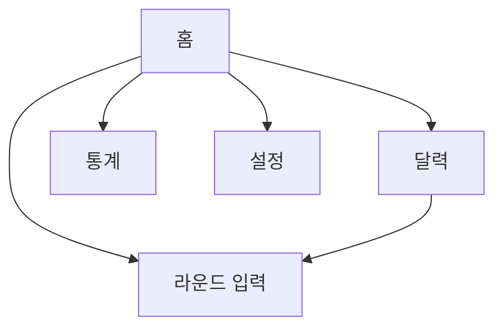

# UI 설계

> 상태: 미착수 (Phase 2에서 작성) · 최종 수정일: 2026-11-26

## 1. 화면 목록
| ID | 화면 | 설명 | 관련 UC |
|---|---|---|---|
| SCR-01 | 홈(이번 달 요약) | 이번 달 수입·라운드 수 | UC-04 |
| SCR-02 | 라운드 입력 | 라운드 등록/수정 폼 | UC-01, UC-02 |
| SCR-03 | 달력 | 날짜별 수입 | UC-03 |
| SCR-04 | 통계 | 월/연 그래프 | UC-04 |
| SCR-05 | 설정 | 골프장 관리, 기본 골프장·캐디피 | UC-07 |
| SCR-06 | 로그인/가입 | 계정 | UC-00 |

## 2. 화면 흐름

## 3. 와이어프레임
TODO: 화면별 와이어프레임 (이미지 또는 Figma 링크)

## 변경 이력
- 2026-11-26 틀 생성
