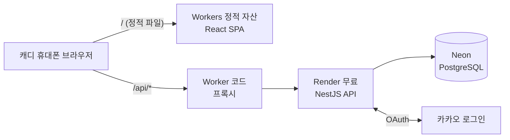

# ADR-0002: 기술 스택 — React + NestJS + Neon, Cloudflare Workers(정적 자산) · Render 무료 배포

> 상태: 승인 · 날짜: 2026-11-27

## 배경 (Context)
Phase 2(설계)에 들어가기 전에 프론트엔드·백엔드·DB·인증·호스팅을 정해야 한다. 관련 요구사항과 조건은 아래와 같다.

- **FR-040** 카카오 로그인
- **NFR-001** 모바일 우선(360px), 라운드 1건 30초 안에 입력
- **NFR-002** 주요 화면 3초 안에 표시 (Should·초안)
- **NFR-003** 사용자별 데이터 완전 분리, 서버 측에서 강제
- **NFR-004** 데이터 유실 방지, 백업 방안
- **NFR-007** 운영비 0원(무료 티어만), **AC-N007-1** 무료 한도를 ADR에 기록
- 일정: 1개월 안 MVP (M3 2026-12-26)
- 목적: 실사용 + **학습/포트폴리오**

사용자 쪽 조건도 있다.
- 프론트엔드 경험은 있고 백엔드는 처음이다. 풀스택 취업을 위해 **Node.js / NestJS 백엔드 API 개발 경험**을 쌓고 싶다. 나중에 Spring으로 다시 만들 계획이 있다.
- 사용자의 Vercel 계정에는 이미 트래픽이 많은 다른 프로젝트가 있다. Hobby 한도는 계정 전체 합산이고, 넘으면 계정 전체가 정지된다. 그래서 **Vercel은 쓰지 않는다.**
- 한도를 피하려고 계정을 새로 만드는 방법은 GitHub·Vercel 약관 위반이다. 포트폴리오 커밋도 원래 계정에 남지 않는다. 그래서 검토 대상에서 뺐다.

## 선택지 (Options)

### 앱 구조
| 선택지 | 장점 | 단점 |
|---|---|---|
| A. React + Supabase(BaaS) | 가장 빠름. RLS로 DB가 NFR-003을 강제함. 카카오 로그인 기본 제공 | 서버 코드가 거의 없어서 백엔드 학습 목적에 맞지 않음. 무료 프로젝트는 7일 미사용 시 일시정지 |
| B-1. Next.js 풀스택 | 프로젝트 하나, Auth.js로 카카오 로그인이 쉬움 | 백엔드가 프론트엔드 프레임워크 안에 들어감. 무료 배포처는 사실상 Vercel |
| **B-2. React(Vite) + NestJS** | 누가 봐도 백엔드 서버. 구조(모듈, DI, 데코레이터, Guard)가 Spring과 닮아서 나중에 Spring으로 옮기기 쉬움. 공고 키워드와 일치 | 학습량이 많음. 무료로 잠들지 않게 호스팅할 곳이 없음 |
| B-3. React + Hono(Cloudflare Workers) | 0원, 잠들지 않음, 같은 도메인 | NestJS가 아님. Workers는 완전한 Node 환경이 아님 |
| C. Firebase | 무료 Hosting과 Security Rules | 카카오 로그인에 Cloud Functions가 필요한데, Functions는 Blaze(종량제, 카드 등록) 요금제가 필요해서 NFR-007과 충돌 |

### NestJS 백엔드 호스팅 (2026-11-27 공식 문서 기준)
| 선택지 | 무료 조건 | 판단 |
|---|---|---|
| Vercel | NestJS 공식 지원 | ❌ 기존 프로젝트와 한도 공유 (위 배경) |
| Cloudflare Workers | 하루 10만 요청, 요청당 CPU 10ms | ❌ NestJS 공식 지원 없음(실험 수준) |
| Netlify | 월 300 크레딧, 함수 실행 1 GB-hour | ❌ NestJS에는 함수 한도가 빠듯함. 넘으면 그 달 남은 기간 정지 |
| Railway | 월 $1 크레딧(매달 초기화), 5~10분 쉬면 잠듦 | ❌ 0.5GB 서버를 평일 8시간만 켜도 약 $2.40 → 월중에 정지될 위험 |
| 클라우드타입 | 메모리 1GB, 카드 등록 필요, **매일 1회 자동 중지** | ❌ 중지를 없애려면 Hobby(월 6,600원)가 필요 |
| Oracle Cloud Always Free | 평생 무료 VM | ❌ 7일 동안 CPU·네트워크 사용률이 20% 미만이면 유휴로 보고 회수할 수 있음. 이 앱은 거의 항상 유휴 상태 |
| **Render 무료** | 월 750 인스턴스 시간, 15분 쉬면 잠듦, 깨는 데 약 1분 | ✅ 0원과 NestJS를 함께 지킬 수 있는 유일한 선택지. 느린 첫 요청은 감수 |

## 결정 (Decision)
**B-2를 채택한다.** 구성은 아래와 같다.

| 영역 | 선택 |
|---|---|
| 프론트엔드 | React + Vite + TypeScript (SPA) |
| 프론트 호스팅 | ~~Cloudflare Pages~~ → **Cloudflare Workers 정적 자산** (2026-11-27 개정, 아래) |
| 백엔드 | **NestJS** + TypeScript, REST API |
| 백엔드 호스팅 | **Render 무료** Web Service, Dockerfile로 배포 |
| DB | **Neon** (서버리스 PostgreSQL) |
| 인증 | 카카오 OAuth 2.0(인가 코드 방식)을 NestJS에서 처리하고, 서버가 httpOnly 쿠키를 발급 |
| 저장소 | 모노레포 하나: `apps/web`(React), `apps/api`(NestJS), 원래 GitHub 계정 |
| ORM·라이브러리 세부 | 데이터 모델 설계 때 따로 결정 → ADR-0003 (Drizzle) |

### 설계 규칙
1. **같은 도메인 유지:** `/api/*` 요청은 Cloudflare Worker(같은 Worker의 코드, `run_worker_first`)가 Render로 대신 전달한다. 그래서 브라우저 입장에서는 도메인이 하나다. 아이폰 Safari의 다른 도메인 쿠키 차단과 CORS 문제를 피하기 위한 규칙이다.
2. **잠든 서버 대응 (NFR-002):** 앱을 열면 바로 `GET /api/health`를 보내 서버를 깨운다. 깨는 동안에는 "서버 깨우는 중" 안내를 보여준다.
3. **`/api/health`는 DB에 접근하지 않는다.** 서버를 깨우는 요청이 Neon까지 깨우지 않게 하기 위해서다. 아래 한도 계산을 참고한다.
4. **서버에 상태를 두지 않는다:** Render 무료 서버는 언제든 재시작될 수 있다. 그래서 로그인 상태는 서명된 쿠키(JWT 등)나 DB로 관리하고 서버 메모리에는 두지 않는다.
5. **NFR-003은 서버에서 강제한다:** 모든 조회·수정 쿼리는 로그인한 사용자 ID 조건을 Repository 계층에서 강제한다. AC-N003-1은 다른 사용자의 ID로 요청을 보내는 자동화 테스트로 검증한다.
6. **처음에는 크론 상시 기동을 쓰지 않는다.** 실사용에서 첫 요청 지연이 너무 불편하면 그때 검토하고 이 ADR을 갱신한다. 검토할 때의 대안은 두 가지다.
   - 크론으로 깨워두기: `/health`만 호출하고, 무료 서비스는 1개만 둔다.
   - Render 유료 플랜으로 전환: NFR-007 변경이 필요하다.

## 무료 한도와 사용량 계산 (AC-N007-1)
기준은 사용자 10명 × 1인당 하루 3라운드 × 1년이다. 한도는 2026-11-27에 공식 문서에서 확인했다.

| 서비스 | 무료 한도 | 예상 사용량 | 비율 |
|---|---|---|---|
| Render | 월 750 인스턴스 시간(워크스페이스 합산), 인스턴스 1개 | 잠들게 두면 실제 사용 시간만 씀. 24시간 켜둬도 최대 744시간 | 최악의 경우에도 99% 이하 (**무료 서비스는 1개만 둔다**) |
| Neon 계산 | 프로젝트당 월 100 CU-시간, 5분 쉬면 잠듦 | 하루 최대 30번 깨어나고 매번 5분 유지된다고 넉넉히 잡으면 0.25 CU × 2.5시간 × 30일 ≈ 19 CU-시간 | 약 19% |
| Neon 저장 | 프로젝트당 1GB (매달 초기화되지 않음) | 1년 약 11,000건 + 인덱스 ≈ 10MB 미만 | 약 1% |
| Neon 전송 | 프로젝트당 월 5GB | JSON 응답 위주, 월 수십 MB | 약 1% |
| Cloudflare Worker (`/api/*`만) | Workers 무료: 하루 10만 요청, 요청당 CPU 10ms(대기 시간 제외) | 하루 약 1,000 API 요청 | 약 1% |
| Cloudflare Workers 정적 자산 | 정적 요청 무료·무제한(Worker 호출 수에 안 들어감) | — | 첫 배포 때 재확인 |

**주의:** 크론으로 깨우는 요청이 DB까지 건드리면 Neon이 24시간 켜진다. 그러면 0.25 CU × 744시간 = 186 CU-시간으로 한도(100)를 넘는다. 약 16일째에 DB가 정지된다 → 설계 규칙 3의 근거.

**한도를 넘으면:**
- Render: 그 달 남은 기간 동안 서비스 정지
- Neon: 다음 결제 주기까지 DB 정지
- Workers: 그날 남은 시간 동안 오류 (UTC 자정 = 한국 시간 오전 9시에 초기화)

## 근거 / 결과 (Consequences)
**좋은 점**
- 실서비스로 운영하는 NestJS REST API, OAuth 직접 구현, PostgreSQL, Docker 배포까지 경험한다. 학습·포트폴리오 목적에 맞다.
- 구조가 Spring과 닮아서 다음 단계(Spring Boot 재구현)로 옮기기 쉽다.
- 운영비 0원(NFR-007)을 지킨다.
- 백엔드는 Dockerfile로 배포하므로 호스팅을 바꿔도 코드는 거의 그대로다. 유료 전환도 Render 플랜만 바꾸면 된다.

**감수할 점**
- **느린 첫 요청:** 서버가 15분 이상 쉬면 첫 요청에 약 1분(커뮤니티 사례로는 최대 3분)이 걸린다. NFR-002에 예외를 추가한다(SRS 변경 이력 참고). AC-N001-3은 서버가 깨어난 뒤부터 30초로 측정한다(Q-025, 사용자 승인).
- **배포가 두 곳:** Cloudflare와 Render 두 곳에 배포하고 프록시를 설정해야 해서 움직이는 부품이 늘어난다.
- **학습량과 일정:** 백엔드를 처음 배우므로 M3(2026-12-26)가 1~2주 밀릴 수 있다. 1주차에 카카오 로그인 → API 하나 → DB 저장을 끝까지 연결해서 위험을 먼저 줄인다.

**구현 전에 확인할 것**
- 카카오 이메일 동의 항목은 비즈 앱 전환이 필요할 수 있다. 이메일 없이 카카오 회원번호만으로 가입하는 방식을 기본으로 한다.
- Workers 정적 자산·Workers Builds 한도와 Worker 프록시 동작(`redirect: 'manual'`, 여러 `Set-Cookie`)을 확인한다.
- 백업(AC-N004-2) 방식은 `architecture.md`에서 정한다. 후보는 GitHub Actions 정기 `pg_dump`와 Neon 복원 기능이다. → **ADR-0006에서 둘 다 쓰기로 결정** (2026-11-27)

**이후 학습 과제 (MVP 범위 아님)**
- 같은 요구사항 문서로 백엔드를 Spring Boot로 다시 만들기 (새 ADR 작성)
- Docker 자체 배포 연습

## 참고 자료 (2026-11-27 확인)
- Render: [FAQ](https://render.com/docs/faq), [Free tier](https://render.com/blog/free-tier)
- Neon: [Free plan limits](https://neon.com/faqs/free-plan-limits-and-quotas), [Plans](https://neon.com/docs/introduction/plans), [Scale to zero](https://neon.com/docs/guides/scale-to-zero-guide)
- Cloudflare: [Workers limits](https://developers.cloudflare.com/workers/platform/limits/), [Workers pricing](https://developers.cloudflare.com/workers/platform/pricing/)
- Railway: [Free plan](https://docs.railway.com/pricing/free-plan), [Pricing](https://railway.com/pricing), [Serverless](https://railway.com/guides/cut-idle-costs-serverless)
- 클라우드타입: [요금제](https://cloudtype.io/pricing)
- Oracle: [Always Free Resources](https://docs.oracle.com/en-us/iaas/Content/FreeTier/freetier_topic-Always_Free_Resources.htm)
- Vercel: [Hobby plan](https://vercel.com/docs/plans/hobby), [Acceptable Use Policy](https://vercel.com/legal/acceptable-use-policy), [NestJS on Vercel](https://vercel.com/docs/frameworks/backend/nestjs)
- Netlify: [Credit-based plans](https://docs.netlify.com/manage/accounts-and-billing/billing/billing-for-credit-based-plans/credit-based-pricing-plans/)

## 개정: 프론트 호스팅 Pages → Workers 정적 자산 (2026-11-27, 사용자 승인)
- 배경: 첫 배포 준비 중 Cloudflare 대시보드의 "만들기"가 기본으로 **Workers**를 만들고, Pages는 **"레거시 Pages 워크플로"**로 표시됐다. 새 기능이 Workers 쪽에 먼저 들어오므로 나중에 옮겨야 할 가능성이 크다.
- 결정: 같은 Worker 하나(`caddy-haru`)가 **정적 자산(SPA)**과 **`/api/*` 프록시 코드**를 함께 맡는다. 설정은 `apps/web/wrangler.jsonc`, 코드는 `apps/web/worker/index.ts`.
  - `assets.not_found_handling = "single-page-application"` → 모르는 경로는 `index.html`
  - `assets.run_worker_first = ["/api/*"]` → `/api/*`만 Worker 코드가 받고, 나머지 정적 요청은 Worker를 거치지 않는다(무료·무제한)
  - `keep_vars: true` → 대시보드에서 넣은 `API_ORIGIN`이 배포 때 지워지지 않게. `PROXY_SECRET`은 비밀(secret)
- 그대로인 것: 같은 도메인 원칙(쿠키·CORS), 프록시 규칙(`redirect: 'manual'`, 헤더 그대로), 비용 0원, Render·Neon.
- 감수할 점: 기본 주소가 `caddy-haru.pages.dev`에서 **`caddy-haru.eomhh99.workers.dev`**로 길어진다(미리보기: `*-caddy-haru.eomhh99.workers.dev`). 카카오 Redirect URI도 이 주소로 등록한다.
- 확인: 로컬 `wrangler dev`에서 `/api/health` 프록시 200, SPA 폴백 200, `_headers` 장기 캐시 적용(2026-11-27).

## 변경 이력
- 2026-11-27 작성·승인 (사용자 선택: React + NestJS, Render 무료, 크론 없이 시작)
- 2026-11-27 후속 결정 연결: 세션 방식 ADR-0004(DB 세션), 데이터 분리 ADR-0005, 백업 ADR-0006, 모노레포 ADR-0007
- 2026-11-27 ORM 결정 연결: ADR-0003(Drizzle)
- 2026-11-27 **개정 (사용자 승인):** 프론트 호스팅을 Cloudflare Pages → Workers 정적 자산으로 (Pages가 "레거시"로 표시됨)
