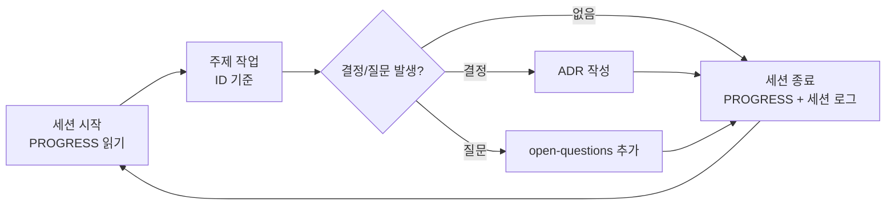

# 세션 지시 가이드

> 새 세션에서 Claude에게 일을 시킬 때 복사해서 쓰는 명령 모음.
> 세션은 이전 대화를 기억하지 못하지만, `CLAUDE.md`는 자동으로 읽는다.
> 그래서 **"무엇을 할지"만 짧게 말하고, 맥락은 문서가 전달**하게 한다.

## 1. 기본 원칙
1. **한 세션 = 한 주제.** "요구사항 인터뷰", "데이터 모델 설계", "라운드 입력 기능 구현"처럼 나눈다.
2. **시작할 때:** PROGRESS.md를 읽고 시작하라고 한다.
3. **끝낼 때:** 문서 갱신(PROGRESS + 세션 로그)을 시킨다.
4. **ID로 지시한다.** "라운드 입력 만들어줘"보다 "FR-001, FR-002 구현해줘"가 정확하다.

## 2. 상황별 명령 템플릿

### ▶ 세션 시작 (공통)
```
CLAUDE.md와 docs/PROGRESS.md를 읽고 현재 상태와 다음 할 일을 요약해줘.
그다음 [할 일]을 진행하자.
```

### ▶ Phase 0~1: 요구사항 인터뷰
```
docs/01-requirements/open-questions.md의 미해결 질문을 나한테 하나씩 물어봐줘.
답변을 받으면 open-questions에 기록하고, srs.md·glossary.md·project-charter.md에 반영해줘.
```

### ▶ 요구사항 정리 / 검토
```
docs/01-requirements/srs.md를 검토해줘.
- 모호하거나 검증 불가능한 요구사항
- 빠진 요구사항
- 충돌하는 요구사항
을 찾아서 제안하고, 내가 승인하면 반영해줘.
```

### ▶ 유스케이스 작성
```
srs.md의 Must 요구사항을 기준으로 use-cases.md의 UC-02~UC-06을 UC-01 형식으로 작성해줘.
```

### ▶ Phase 2: 설계
```
docs/01-requirements/ 를 읽고 docs/02-design/architecture.md를 작성하자.
기술 스택은 선택지 2~3개를 비교해서 제안해주고, 내가 고르면 ADR로 남겨줘.
```
```
srs.md와 glossary.md를 기준으로 docs/02-design/data-model.md의 ERD와 엔티티 정의를 작성해줘.
각 컬럼에 관련 요구사항 ID를 적어줘.
```

### ▶ Phase 3: 구현
```
FR-001, FR-002를 구현하자.
docs/02-design/ 의 설계를 따르고, 설계와 다르게 해야 하면 먼저 나한테 말해줘.
테스트도 같이 작성하고, srs.md의 추적성 매트릭스를 갱신해줘.
```

### ▶ 결정이 필요할 때
```
[주제]에 대해 선택지를 비교해주고, 결정되면 docs/templates/adr.md 형식으로 ADR 남겨줘.
```

### ▶ 세션 종료 (공통) ★ 매번
```
오늘 작업 마무리하자.
docs/PROGRESS.md 갱신하고, docs/05-sessions/에 오늘 세션 로그 남겨줘.
```

## 3. 진행 흐름 한눈에 보기


## 4. 팁
- 한 세션 대화가 너무 길어지면 종료 명령으로 정리하고 새 세션을 여는 게 낫다. 문서가 있으니 맥락은 이어진다.
- 문서가 실제와 어긋나 보이면: `"docs와 실제 상태가 맞는지 점검해줘"`
- 코드 작업을 시작하기 전에 `git init`을 해두면 문서 변경 이력도 남길 수 있다.
